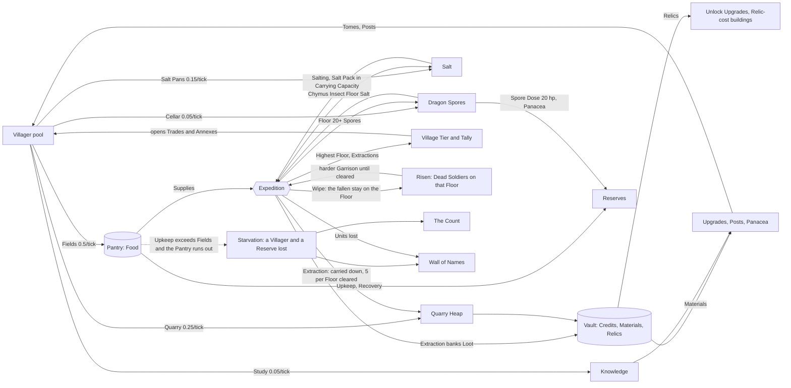

# Tower Dungeon: Village Resources Brainstorm

Ideas only. No code or repository files are changed. Terms follow `CONTEXT.md`. Numbers were checked against `GameProperties`, `application.yml`, `Village.java`, `GameState.java`, `GameService.java`, `UnitStats.java`, `EnemyStats.java` and `UpgradeType.java`.

The Village reads as a place holding on at the foot of the Tower, not as a clicker tree: its names, consequences and presentation are chosen for that.

## Decisions made

Decided by the author:

- **Package B (Balanced) is the base.**
- **Trades.** One Villager pool, assigned to Fields, Quarry and Scribe's Study (R01).
- **The Stockroom.** A separate store for Village-produced goods. The Vault stays the store of banked Loot.
- **Renames.** **Village Tier** (not Standing; the author prefers Tier). It is written "Village Tier" because `CONTEXT.md` lists "Tier" under the avoid terms of Floor Difficulty; see the glossary ruling below. Knowledge (not Lore).
- **Wipe consequences.** A Wipe costs the Party, its carried Loot and one Tower-side consequence, the Left Behind's Risen (D1). It burns no Trust.
- **Trust.** The Thought-Binding Ring costs 10 Trust at its first level, x1.5 per level, five levels (about 132 Trust in all). Each level adds Reinforcement Wave speed and Wave Carrying Capacity.
- **Maiming.** Lost body parts are permanent (the Unit depth milestone, ADR 0006). A Spore Dose is the remedy: it reattaches an arm or a leg (R07).
- **Persistence and Prestige are in scope.** Save and resume, and Prestige as the campaign's reset, are to be designed alongside the Village. The dedicated design is `docs/brainstorm/prestige-and-persistence.md` (in progress). Persisted state includes the Tally, the Stockroom, Trust, The Count, the Wall of Names and Risen.
- **Expedition Loadout panel.** The place where the player chooses what to bring.
- **Salt and Dragon Spores chains** (R05, R07).
- **Tone: serious, bleak, attrition-driven.** Fear of the unknown, survival, perseverance, corruption. Gains are hard-won relief. Losses are felt. Tower Wizard is a mechanical and technical inspiration only: shared worker pool, cumulative gating, limited-palette pixel and dither technique, flat bordered UI, visible workplaces. Its cheerful feedback is not imported (see the tone rules in sections 2 and 8).

Still open, to be decided in the Prestige and persistence design:

- **Persistence details.** Identity, storage, save cadence, and what happens to an Expedition in progress. Today `closeSession` drops all state.
- **Prestige details.** What resets and what is kept. The working framing is succession and not a bar to fill: the Village outlives the Campaign, and the next Party inherits only what the Chronicle records. Copy in section 8 should not promise either way until that design lands.

Proposed in this revision, awaiting the author:

- Package A as the first slice of B, and Package C as where the rest waits.
- The names in section 8.2 (Tillers, Breakers, Posts, Settling, Emergency Tilling and the rest).
- The split of the dread layer: one Tower-side slice in B, the rest in C, two items rejected (section 4, Theme F).
- The Stockroom cap formula (section 2).
- The overcast light theme and the sound policy (section 8).

## Terms to add to `CONTEXT.md` if you adopt the ideas

Package B terms:

- **Trade** (what a Villager does: Tillers in the Fields, Breakers in the Quarry, Scribes in the Scribe's Study, later Salters and Sporewardens). **Post** (one place in a Trade, "4 of 10 Posts"). **Settling** (the short wait after a Villager is moved). **Emergency Tilling** (Villagers returned to the Fields while the Pantry is low and Upkeep exceeds Fields output).
- **Knowledge** (a Trade product). **Tome** (a Village-side Repeatable Upgrade bought with Knowledge). **Village Tier** (a Village progression level). **Tally** (the never-spent counters that gate Village Tier). **Stockroom** (the Village's store of produced goods). **Quarry Heap**. **Salt**. **Salt-bearer**. **Dragon Spores**. **Spore Dose**. **Panacea**. **Trust**. **Thought-Binding Ring**.
- **Loadout** (the panel where the Party's Supplies and consumables are chosen before setting out).
- **Ledger** (the Village's log of events; the Expedition Summary is its entry for an Expedition, styled as the Extraction ledger, Wipe ledger or Summit Conquered ledger). **The Count** (what the Campaign has lost to Starvation). **Wall of Names** (the fallen Units).
- **Risen** (Dead Soldiers raised on the Floor where a Wipe ended, carrying the fallen Unit's name).

Package C terms, to add only when adopted: **Pall**, **Rites**, **Bear** (a body home), **Toll Floor**, **Toll**, **Writ**, **Sentry Line**, **Sentries**, **Grievous**, **Short Measure**, **Sealed Stores**, **Cistern**, **Mana Stone**, **Tolerance**, **Leaving-Place**, **Survivors from the Floor above**, **the Stair**, **Repair**, **Survey Notes**, **Intel**, **Survey Map**.

Rulings:

- **Village Tier** is the author's name for the Village progression level. **Glossary conflict:** `CONTEXT.md` lists "Tier" among the avoid terms of **Floor Difficulty** ("_Avoid_: Tier, threat level"). Resolution proposed: adopt "Village Tier" as the term, always written in full, and amend the Floor Difficulty entry's avoid list to read "Tier (on its own), threat level" so that "Village Tier" is the only Tier in the game.
- **Knowledge** is the name for the Scribes' product, not "Lore", because the Milestone `RELIC_LORE` ("Relic Lore", +25 carry) already exists and the two would collide in the UI.
- **Tally** replaces "Lifetime Ledger". The feedback log is now the Ledger, and the word "lifetime" is avoided until the persistence design settles what the Tally spans (one Campaign, or across Prestige).
- **Stockroom** is new. Produced Salt and Spores are not kept in the Vault and are not Loot, because the glossary says the Vault holds only banked Credits, Materials and Relics and that only Extraction adds to it. Goods that Villagers make directly need their own store, as Food has the Pantry.
- If Salt, Spores or Survey Notes also turn up as Loot, widen the **Loot** definition (today: Credits, Materials, Relics) and the **Vault** definition. R03 would likewise widen **Milestone**. **Expedition Summary** is extended, not replaced: the Ledger variants carry the same fields.
- **Tome** is paid from the Stockroom, but the glossary defines an Upgrade as bought "with materials or relics from the vault". Either widen **Upgrade** and **Repeatable Upgrade**, or keep Tome as its own term. Decide when adopting.
- **The Stair** replaces "The Mending". "Mend" is on the glossary's avoid list (for Heal), and the research does not call the repair a mending anyway.
- **Prestige** keeps its current definition (starting the Campaign over after it has ended, for prestige points). It is now in scope; its design lives in `docs/brainstorm/prestige-and-persistence.md`.

Source tags used below: **[Manga]** means the fact is in `docs/research`, with the research's own confidence label after it (official, review, wiki, fan). **[Manga, low trust]** means fan lists or single sources. **[Invented]** means original to Tower Dungeon. **[TW]** means borrowed from Tower Wizard as technique. Anything not tagged as manga is not manga canon.

---

## 1. Where the village economy stands today

- Food is the only produced resource. 20 Villagers at 0.5 Food per tick give 10 Food/tick. The Pantry starts at 100. Villagers eat nothing, so only Reserves have Upkeep. One tick is one second (`lifecycle-ms: 1000`), so the design text says "tick" and the UI says "s".
- Food is also the only survival resource. Reserves eat 1.0 Food per tick as Upkeep. Supplies drain at 1.5 per Unit per tick on the Tower.
- **Recovery is serial.** `RoundRobinFoodDistributionStrategy` heals one wounded Reserve per tick, at up to 5 hp per tick and 1 Food per hp. Recovery therefore costs at most 5 Food/tick in total and never runs in parallel. Unit max health is 10 to 50 (Draco-Metamorph 100), so no Unit carries a 100 hp wound except the Draco-Metamorph.
- **Starvation fires on a tick when Pantry + Fields output - Upkeep comes to zero or less.** That check runs before Recovery. When it fires, one Villager and one random Reserve Unit die that tick. An empty Pantry is not Starvation by itself. Recovery spends after the check, so Recovery can empty the Pantry but cannot cause Starvation. If Fields output covers Upkeep, an empty Pantry only stops Recovery and Supplies. Let d = max(0, Upkeep - Fields output). Starvation begins on the first tick when the Pantry is at most d. Every "Pantry holds" figure below is derived from this.
- Credits start at 10. The n-th Villager costs n Credits, so the 21st costs 21. Food sells for 1 Credit each, Materials for 2 and Relics for 25. Selling the 10 Food/tick harvest would give 10 Credits/tick, so a Villager pays for itself in about 2n ticks. The Villager pool is cheap to grow, and Credits are the only limit on it.
- **Loot scales with the Floor number.** Clearing Floor f gives 2f Credits, 5f Materials and 3 Supplies (flat), and no Relics: Relics come only from surplus items, banked at Extraction (1 per Leftover, 3 per Talisman). Guardians pay 3x. Worked example: an Expedition that clears Floor 10 banks about 375 Materials and 150 Credits, plus one Relic for each surplus Leftover its Party carried out. Selling Materials (2 each) is the main Credit source, and it dwarfs the direct 2 Credits per Floor.
- **Garrison size scales with the Floor number.** The budget is 3 + 0.8f + 0.04f^2 (+/-25%), x1.5 on Surge Floors (every 5th Floor). Every 10th Floor holds a Guardian instead. Floor 7 is about 10.6, Floor 9 about 13.4, Floor 12 about 18.4, and Floor 5 (a Surge Floor) about 12. Each Easing step removes 25% per Guardian slain above (`ease-budget-per-boss`), never below half the base budget (`ease-budget-floor`) and never more than 60% in total (`ease-budget-cap`). A Dead Soldier weighs 1.0 in that budget (`EnemyStats`: 15 hp, 5 damage, weight 1.0).
- Loot reaches the Vault only on Extraction (or Summit Conquered). A Wipe loses it.
- Upgrades:
  - Five Unlock Upgrades cost 40, 85 and 110 Materials, then 3 and 8 Relics.
  - Two Repeatable Upgrades: Supply Lines (+25 Carrying Capacity, 30 Materials x1.6/level) and Sharpened Arms (+10% damage, 35 x1.7/level).
  - **Materials are abundant.** A Floor-6 Expedition (105 Materials) buys the Tank, and the two Repeatable Upgrades already give exponential sinks plus a sell valve. The dead-currency risk is **Relics**. Only 11 Relics of one-time sinks exist and the surplus of a few Expeditions covers them, so afterwards Relics are only worth their 25 Credits sale price.
- Carrying Capacity is 100 base, +60 per Porter, +25 per Supply Lines level and +25 from the Relic Lore Milestone.
- Milestones are free, one-time and driven only by Highest Floor or Expedition count.
- Shortcuts exist at Floors 3, 5, 10 and 15.
- Villagers have no Trades, no workplaces and no other production. The Village has no buildings.
- There is no persistence. `closeSession` drops the whole state, so nothing produces while no one is connected, and every counter or Stockroom stock resets on restart. Prestige is unbuilt.
- There is no `backend/src/test` directory, so every rate change is unguarded.
- **The Village panel today speaks in avoided words and a soft register.** `village-management.html` says "Food pantry", "idle units", "standby", "Buy villagers", "Sell food". `Village.java` has the comment "idle (standby) units". The panel uses 14 px corners, gradients, a lift on hover and a green positive rate. The Tower scene already carries the right register: night mode (`#0e1424`), Guardian slab `#7a2230`, and a light mode of sky blue `#9fc0e8`.

## 2. Design thesis

**Make the Village a place where every Villager is a hand that must be spared from the Fields, so that each Trade is a wager against Food, and make every product pay off on the Tower.**

The structure comes from Tower Wizard [TW, section 3b]: one shared pool of hands assigned to workplaces, an opportunity cost on every assignment, and a converter or second long-lived sink for each currency. Only the structure is taken. In Tower Dungeon the pool is the Villager pool and the opportunity cost is Food (0.5 Food/tick, which would sell for 0.5 Credits). Food is also what keeps the Reserves alive, so a bad assignment is dangerous and not only slow. No Villager is idle. A hand is at Labour, or it is in the Fields. The player's text and this document use Labour, Hold and Wait, never Idle.

Caveat: the opportunity cost is weak today. A Villager costs n Credits and eats nothing, so a player can buy the pool back quickly (one Floor-10 Expedition funds about 26 more Villagers if every Material is sold). The real governors are the Posts, the Tiller minimum and the Starvation rules below. Starvation must therefore be made legible, since a cheap loss is easily ignored. Each Villager lost is stated, by Trade, in the Ledger, and The Count keeps the total for the Campaign. The Villager price curve is re-measured after R01, and a steeper curve is the first lever. No new Food rate is added.

**The Tiller minimum is a floor, not a safeguard.** At the start, the 4 Founders in Reserves eat 4 Food/tick, so the Fields cover Upkeep only with 8 Tillers. A player may legally move 15 hands off the Fields (5 Tillers, 2.5 Food/tick, d = 1.5) and begin a Starvation clock. That is the wager. It stays legible and avoidable because the assignment row previews the margin before the move (section 8.3), Emergency Tilling answers it (R01), and nothing blocks the player.

The loop is Labour, then Loadout, then the gamble, then Extraction, then Labour again:

1. **Labour (Village).** Assigned Villagers draw Salt, Spores and Knowledge into a capped Stockroom while the Party is away and the Pantry is watched.
2. **Loadout.** Before an Expedition the player decides what to spend. Salt can salt Supplies or be packed against Chymus Insects. Spores are kept for Spore Doses. The panel states what setting out leaves in the Pantry.
3. **Gamble.** Push higher or Extract.
4. **Extraction.** Only Extraction banks Loot, advances the Tally and delivers the Quarry Heap. The Village sees who came home before it sees what they carried.

The manga supplies the weight: salt against Chymus Insects [Manga, review and wiki], Dragon Spores on Floor 20 [Manga, wiki], the hidden staircase [Manga, review and wiki], the dead becoming undead [Manga, wiki] with the Necromancer controlling the corpses left on each Floor [Manga, review], and trust between survivors [Manga, official vol 7 blurb]. That the dead rise on the very Floor where they fell is [Invented], an extension of those two facts. These give the new resources a cost that Tower Wizard's reskinned chains lack.

Guardrails:

- **Every source that works while the Party is away must be capped or settle on Extraction. Otherwise waiting beats going up.** Scaling output with Highest Floor alone still lets output accumulate without limit. So:
  - Stockroom stocks (Knowledge, Salt, Spores) each have a capacity of 60 + 4 per Highest Floor (config `stockroom-base` 60, `stockroom-per-floor` 4). Output beyond the cap is wasted, and the Ledger says so plainly.
  - The Quarry Heap has its own cap and a per-Floor delivery limit (R01).
  - The Knowledge cap cannot always exceed the next Tome's cost, because Tome costs grow x1.5 per level and the cap grows linearly. The rule is: the cap must be at least the cost of the next Tome level. At 60 + 4 per Floor, level 1 (60) is reachable at the start, level 2 (90) needs Highest Floor 8, level 3 (135) needs Highest Floor 19, level 4 (202) needs Highest Floor 36. A level the Stockroom cannot hold is shown as gated, with the reason: "Tome 2 costs 90. Stockroom holds 80. Needs Highest Floor 8." A test asserts this in build step 1.
- **Ship exactly one new Tower-side Wipe consequence and no new Food rate, and make it legible and avoidable by good play.** Tower side: a thin slice of the Left Behind (D1, Risen). No Wipe consequence reaches into a currency the player has banked, so Trust is never burned. Food side: the pressure is the existing Starvation, made visible by the Pantry's hold line, the named losses and The Count. No consequence may reduce Food income below the 10 Food/tick baseline or stack on Starvation. R06 spoilage stays off until hoarding appears.
- **No tap or attention bonuses.** The Village does not reward watching it. The only active input is the Trade assignment and the Loadout. If an attention mechanic is ever wanted, it must be a decision with a cost, for example a Sleepless Study toggle: Study output x2 while the Pantry is below 60 and the Party is out, with Emergency Tilling exempting the Scribes. Not proposed.
- **No pulse, flash, chime or particle on production, on a counter crossing a threshold, or on the Stockroom filling.** Loss is the only thing allowed a sound (section 8), and nothing in the Village flashes.
- Expedition-side consumables share Carrying Capacity (100 base, +60 per Porter, +25 per Supply Lines level). A 5-capacity cost is trivial next to a Porter, so consumables are priced at 10 to make the trade-off real. The Loadout panel is needed mainly because no surface exists today to choose what to bring.

## 3. Resource map

| Resource | Produced by | Spent on | Relates to |
|---|---|---|---|
| Food (existing) | Tillers (default Trade) | Upkeep, Recovery, Supplies, sold (1 Credit each) | Pantry; the opportunity cost of every Trade |
| Credits (existing) | Floors, selling | Villagers, Recruiting Units | R14 cuts Villager price via Survivors from the Floor above |
| Materials (existing) | Loot, **Breakers** (new, via the Quarry Heap) | Unlock and Repeatable Upgrades, Posts, buildings, Panacea; Burial in C (D2) | Already abundant; Posts, buildings and Panacea are the new sinks |
| Relics (existing) | Surplus items a unit finds that are no better than what it carries, turned into Relics at Extraction (1 per Leftover, 3 per Talisman); floors pay none | Necromancer, Draco-Metamorph, Relic-cost buildings (not yet specified); Writs in C (D7) | Never produced by the Village (R10 dropped). Needs the new sinks, since the existing ones total 11 |
| **Knowledge** (new, Stockroom) | Scribes (Scribe's Study) | Tomes (Village Repeatable Upgrades) | Capped by Stockroom capacity (60 + 4 per Highest Floor) |
| **Quarry Heap** (new, a buffer) | Breakers | Carried to the Vault by the Party that came home, up to 5 Materials per Floor cleared in that Expedition | Keeps Village Materials tied to Expeditions. A Wipe leaves it at the Quarry |
| **Salt** (new, Stockroom) | Salters; rare Loot on Chymus Insect Floors | Salting, Salt Pack, sold (2 Credits); Satchel and Pyre in C (D4, D2) | Only the Salt Pack rides in Carrying Capacity; links to Supplies drain |
| **Salted Supplies** (Loadout state) | Salt applied to Supplies | Drain 1.5 down to 1.25 per Unit per tick | Competes with Supply Lines and Porters |
| **Dragon Spores** (new, Stockroom; also Loot-capable) | Sporewardens; Loot at Floor 20+ | Spore Dose (20 hp each), Panacea, sold | Skips Recovery's wait and halves its Food cost per hp |
| **Panacea** (new consumable) | 4 Spores + 40 Materials | One death-save per Party | 10 Carrying Capacity each |
| **Tally and Village Tier** (new, never spent) | Food grown; Credits and Loot banked on Extraction; Highest Floor | Nothing; they gate Trades and buildings | Milestones. Whether the Tally outlives a restart is open |
| **Trust** (new, not sellable) | Extraction, scaled by survivors / Party size; Wave Merges | Thought-Binding Ring levels (max 5) | Never lost: a Wipe earns none and takes none. Shown in the Loadout |
| **Risen** (Floor state, not a currency) | A Wipe: Units that fell on the Wipe's last Floor | Removed by clearing that Floor once | Adds Dead Soldiers to that Garrison, capped (D1) |
| **The Count** (a record) | Villagers and Reserves lost to Starvation | Nothing | Shown in the Stock panel and the Ledger |
| **Wall of Names** (a record) | Every Unit lost on the Tower or to Starvation | Nothing | Shown in the Village panel (D8) |
| Mana Stones, Survivors from the Floor above, Tolerance, Survey Notes, Intel, Survey Maps, Bodies and Pall (Package C) | See section 4 | See section 4 | Optional later systems |



## 4. The ideas, grouped by theme

Scores are fun / fit / feasibility, then the average (all averages re-checked). Judges' scores are as given for R-ideas. The D-ideas come from the dread pass and are not scored; they carry a size and a placement instead.

### Theme A: The Villager pool and what it makes

#### R01 Trades: one Villager pool, assigned to Fields, Quarry and Scribe's Study
- **Size:** M. **Scores:** 5 / 4 / 4, avg 4.33. **Source:** [Invented] on [TW] section 3b. Called Trades because the glossary avoids "role" and "worker".
- **Pitch:**
  - The Village panel gets an assignment row with +/- steppers. Every Villager is a Tiller by default at 0.5 Food/tick, which is unchanged. Every hand moved off the Fields shows its price in the Stock panel, and the stepper previews the margin after the move: "Fields +7.5. Upkeep -8.0. Pantry holds 99 s." It warns when Fields would no longer cover Upkeep. It never blocks.
  - **Fields has no Post cap**, because it must hold the starting 20 Tillers. Posts apply to the other workplaces.
  - Breakers make Materials at **0.25/tick** each. Scribes make Knowledge at 0.05/tick each. Both are multiplied by (1 + 0.02 x Highest Floor). The Village has learned what the lower Floors leave behind, so the Trades yield more from known ground. The display states it as a fact and not as a bonus: "Highest Floor 12. Quarry yield +24%." Only Floors already discovered count. [Invented; the config value stays 0.02.]
  - Why 0.25: a Tiller's 0.5 Food/tick sells for 0.5 Credits, and 0.25 Materials sells for 0.5 Credits. At 0.10 the Quarry was strictly dominated even at sale price. At 0.25 it is at parity at Highest Floor 0 and improves with Highest Floor.
  - Knowledge buys Tomes, a Village-side Repeatable Upgrade track. The Scribes write down what the survivors say, and every Tome exists because someone came back [Invented]:
    - **Tillers' Record:** Fields +25%.
    - **Seam Charts:** Breaker output +25%.
    - **Survivors' Notes:** +10 Carrying Capacity per level, Reinforcement Waves only. This is the Tome that pays off on the Tower; the other two only feed more Village production, a closed loop.
    - Cost 60 Knowledge x1.5 per level, unchanged. Levels beyond what the Stockroom cap can hold are gated by Highest Floor (section 2).
  - Moving 5 Villagers to the Quarry takes Food from 10 to 7.5/tick and adds 1.25 Materials/tick, worth 2.5 Credits/tick if sold, which equals the 2.5 Credits of Food given up.
  - Each non-Fields workplace starts with 10 Posts and gains 5 per level for 25 Materials x1.6 per level. A moved Villager is Settling for about 10 ticks before it can be moved again.
  - Workplaces are revealed by Highest Floor, or by Village Tier once R02 lands.
- **Guards:**
  - A minimum of 5 Tillers (an assignment limit only, and not a safeguard, see section 2).
  - **Starvation picks a random Villager weighted by headcount, exactly like today.** A "newest-Trade first" rule is rejected: it would shield the Fields and quietly make Starvation cheaper, since the Reserves still die but the Food income never drops. If a softer rule is preferred, state it as a deliberate easing.
  - **Starvation is stated, not absorbed.** The Ledger names the loss: "Starvation. 1 Breaker lost. Tomas, Archer, lost." Villagers are counted by Trade and never named. Reserves are named with their Unit Type. The Stock panel carries The Count: "Lost to Starvation: 3 Villagers, 2 Reserves (this Campaign)". No new numbers on Food, so no extra spiral risk.
  - **Emergency Tilling** (not "auto-recall": Recall is a glossary term for Reinforcement Waves). It triggers when the Pantry is below 20 Food and Upkeep exceeds Fields output (d > 0). A "negative net rate" trigger is rejected because it includes Recovery, which would fire it when the Fields cover Upkeep and no Starvation is possible. It ends once the Pantry passes 60 (hysteresis). While it runs it moves one Villager per tick to the Fields, from the Trade holding the most hands, until Fields output covers Upkeep or only Tillers remain. A Villager still Settling is not pulled until it has settled, and the 5-Tiller minimum still holds, so the near-miss is felt and cannot cascade. It is never silent. One Ledger line is written: "Emergency Tilling. Pantry below 20. Breakers moved to the Fields." Locked Trades read "Held at the Fields until the Pantry passes 60." A trigger of "below one Expedition's Supplies" would fire at 100 Food and flicker on every setting out, because setting out takes up to 100 Food from the Pantry.
- **Quarry Heap:**
  - Quarry output lands in the Heap, not the Vault. The Heap cap is 10 x Highest Floor (config).
  - The Heap is a carried load. On Extraction the Party that came home carries it, and it delivers up to **5 Materials per Floor cleared in that Expedition** (the existing `materials-per-floor`), and the rest stays in the Heap. On a Wipe no one carries it. It stays at the Quarry as a stack, is not destroyed, and the cap is unchanged. Copy: "No one came down to carry the Heap." [Invented fiction.]
  - Delivering everything on any Extraction would let a one-Floor Extraction take the full Heap each cycle and bypass the gamble, so delivery is tied to Floors cleared.
  - Check that exactly one limit usually binds. With 5 Breakers at Highest Floor 5 (1.4 Materials/tick) a 30-tick cycle makes about 41 Materials against a 25 delivery cap for a 5-Floor Expedition.
- **Main risk:**
  - The shared pool plus Starvation can spiral, which the guards address.
  - Materials are already abundant, so the Quarry matters only if new Materials sinks (Posts, buildings, Panacea) ship with it.
  - Villager price: the n-Credit curve plus no Villager Upkeep means the pool is cheap to grow. Posts and the Tiller minimum do the real limiting. Re-measure and consider a steeper curve.

#### R05 Salt Pans: Salting and the Salt Pack against Chymus Insects
- **Size:** M. **Scores:** 4 / 5 / 3, avg 4.0.
- **Source:**
  - [Manga, wiki and review] Salt dissolves the Chymus Insect's mucus layer, and the slime targets whoever carries salt. Yuva carries "more salt than water" and is the salt-scattering master. Ruins-Dwellers cook insects with salt.
  - [Invented] Salters, Salt Pans, Salting, the Salt-bearer and every number.
  - Salt is specified only for the Chymus Insect, so the Pack applies to Chymus Insects only, not Slimes (the game's Slime is invented).
- **Pitch:**
  - 4 Salters (Food 10 to 8/tick) make **0.6 Salt/tick** (0.15 each), so 10 Salt takes about 17 ticks.
  - **Salting** (not "Cure": "cure" is on the avoid list for Heal): 1 Salt salts 10 Supplies, with no Carrying Capacity cost because it is used up before departure. Salted Supplies drain at 1.25 instead of 1.5 per Unit per tick. A 6-Unit Party on 100 Supplies lasts about 11 ticks plain (100 / 9) and about 13 salted (100 / 7.5).
  - Salting is a net Food loss on purpose. 10 Salt costs about 33 Food of forgone Farming and saves about 17 to 20 Supplies. It pays only when Carrying Capacity, not the Pantry, is the binding limit, which is the case once the Pantry is large.
  - **Salt Pack:** it takes 10 Carrying Capacity. 1 Salt per Chymus Insect gives +50% damage on it. Chymus Insects target the carrier, so you choose one Salt-bearer, such as a Tank, and the Loadout marks it.
  - Surplus Salt sells for 2 Credits. Each Salt costs about 3.3 Food of forgone Farming, so selling is a loss and only a dump valve for a full Stockroom, not a source of Credits.
  - Rare Salt Loot is found on Chymus Insect Floors.
  - Salt has more claims in Package C: Salting the Dead (D4) and the Pyre (D2).
- **Main risk:**
  - Salting could obsolete Supply Lines, so start at 1.5 to 1.25 and tune.
  - The Pack needs a Weakness-override hook, so ship Salting first and the Pack second.
  - It requires R01 and the Loadout panel.

#### R07 Spore Cellar: Dragon Spores, Spore Doses and Panacea
- **Size:** M (staged). **Scores:** 4 / 5 / 2, avg 3.67.
- **Source:**
  - [Manga, wiki] Floor 20 has potable water and Dragon Spores. Dragon Spores are a cure-all mushroom and the Panacea ingredient. Spores and Panacea heal quickly, even reattaching limbs, and healing is a resource, not time.
  - [Invented] the Cellar, Sporewardens, the Spore Dose rate, the reattachment rate, beds, Panacea as a death-save, the recipe and all numbers.
- **Pitch:**
  - 6 Sporewardens (3 Food/tick forgone) make 0.3 Spores/tick, so one Spore costs about 10 Food. Loot adds 1 Spore per cleared Floor from Floor 20 (x3 on Guardian Floors), banked on Extraction. A Floor-25 Expedition yields about 8 Spores.
  - **Spore Dose:** 1 Spore heals **20 hp** at once, spent on the Unit's most wounded Body Part first (40 would be a near-full heal for every Unit but the Draco-Metamorph). A Dose can instead **reattach one lost arm or leg** at 25% of that part's maximum health, which is the only way a Maimed Unit recovers a part. Head and torso are never lost, because losing either kills. Recovery for 20 hp costs 20 Food and 4 ticks of the single serial queue. A Dose costs about 10 Food of Spore and no waiting. Its real value is **tempo**, since Recovery heals one Unit per tick, and a Food saving of at most 5 Food/tick.
  - **Panacea:** 4 Spores + 40 Materials (10 Materials would be trivial next to 5f per Floor), 10 Carrying Capacity each, capped at 1 per Party. It stops one Unit dying to a killing hit on its head or torso and leaves that part at 10% of its maximum.
  - **Beds** are the optional third phase. Today Recovery already heals one Unit per tick. A bed gives one extra Unit per tick of Recovery, and 1 bed reproduces today's behaviour. Beds are therefore a Recovery upgrade, not a restriction.
- **Staging:** Build Spores and Spore Dose first, then Panacea, and treat beds as optional.
- **Main risk:**
  - Four systems in one, and Spores as Loot need Vault, Stockroom and Expedition Summary UI plus a glossary widening.
  - More beds mean up to N x 5 Food/tick of Recovery, which can drain the Pantry and bring Starvation sooner. Tune against R04's numbers.
  - Panacea needs a damage-handling hook. One save barely changes Wipe stakes, since a Wipe needs every Unit dead, so the 1-per-Party cap is cautious.

### Theme B: Making it visible and readable

#### R26 Village Elevation: Annexes, single-file lanes, Vault Annex, Easing in the Tower
- **Size:** M. **Scores:** 4 / 5 / 2, avg 3.67. **Source:** [TW] section 5b technique (annex buildings on a tall tower, dither, visible workplaces), with original Easing and Wipe cues. Renamed from "Village Diorama": a diorama is a toy, and an elevation is a cutaway architectural view, which is closer to the "white Nihei" look [Manga, review, section 11].
- **Pitch:**
  - Annexes (Fields, Quarry, Salt Pans, Spore Cellar, Pantry silo, Vault Annex) are plain stone masses hung off the Tower at the Base, joined by bridges, with generous empty wall around them. (Not "Vault Hall": the glossary avoids "hall" for Floor.)
  - Villager sprites are one grey ash silhouette. The Trade is shown by what is carried and where they walk: a basket, a stone, a scroll. Lanes are sparse single-file paths in large empty space, so a thin lane reads as "few left". Keep 1 sprite per 2 Villagers and the cap of 40, and treat the count as a roll-call, not a growth display.
  - **Starvation:** a starved sprite stops where it stands, stays still at its workplace for about 10 ticks, then is removed with no effect, and the Annex's window goes dark. The Ledger logs "Starvation: 1 Villager, 1 Reserve Unit." Nothing rises. Undeath for the Village's dead is not implied, because the research does not support it for the Village.
  - **Extraction:** the survivors walk in at the gate and set down crates one at a time with no particles. Their count is shown before the Loot.
  - **Wipe:** no dissolve. The gate stays empty and a lantern in the Annex goes out. The empty lane is held on screen for about 3 seconds, then the Ledger lists what was carried and not recovered. The lost Loot is plain text, not an effect. Gains read as relief. Losses are held longer.
  - **Easing** is a thinning of the dark, not a recolour. Below a slain Guardian each slab gets a thin pale edge line and a few lit windows. Above it, slabs stay pure shadow. A Guardian Floor keeps the existing `#7a2230` slab. The hue never changes and there is no whole-scene palette swap. [Easing is a game rule, Invented; the look is [Manga, review, section 11].]
  - **Reference pillar:** the Village carries one pillar showing the Highest Floor, carved beside the Village Tier display. Non-mechanical set dressing. [Manga, wiki: each Floor has a reference pillar, and 12 main pillars run the full height.]
- **Judges' note:** It is presentation only and multiplies the other ideas, so ship a slice with R01.
- **Main risk:**
  - The Tower scene builds only discovered Floors and follows the battle. A second camera mode is a real scene-graph change.
  - Mitigation: use a fixed Village vantage with a fade to the battle view, or ship a 2D mini-map first.
  - Use instanced sprites with a capped count.

#### R04 Stock panel with per-source rates and the Pantry's hold (and gated Autobuy)
- **Size:** M (panel S, Autobuy separate). **Scores:** 3 / 3 / 4, avg 3.33. **Source:** [TW] section 5b and 3b quality-of-life gaps. Named "Stock panel" because the glossary avoids "Resources" for Vault and Materials.
- **Pitch:**
  - A flat panel in plain text columns with an icon per resource, the stock, the net rate and a tooltip listing each source and sink. Sections: Pantry, Vault, Stockroom, Tally.
  - Numbers change in steps. There is no count-up animation, no "+N" floaters and no flash on income.
  - The margin is shown before the gain. **Pantry holds** means the time until Starvation begins, computed from the code in section 1: with d = max(0, Upkeep - Fields) and r the Recovery spend (5.0 ceiling while any Reserve is wounded), it is (Pantry - d) / (d + r), rounded down. Example: 14 Reserves, Fields +10.0, Upkeep -14.0, Recovery -5.0 (the maximum, since it heals one Unit per tick), net -9.0, and "Pantry holds 10 s at current rates." in crimson at 100 Food ((100 - 4) / 9). With no wounded Reserve the net is -4.0 and the Pantry holds 24 s. With 4 Reserves the Fields (+10.0) cover Upkeep (-4.0), so no Starvation is possible, the Pantry only stops Recovery when it empties, and the line reads "Pantry holds. Fields cover Upkeep."
  - The Pantry line carries its remedy when it is grim (copy in section 8.3).
  - `Village` already separates `getProductionRate` and `upkeepFor`, but Recovery spend is **not** exposed. `healHomePartyWithFood` returns void and the strategy's return value is discarded, so the panel needs a small instrumentation change.
- **Recommendation:** Ship the panel. Defer Autobuy or lock it behind a Milestone with a minimum Credits balance and a cost cap. A [TW] reviewer (one 5/10 review) criticises Autobuy as decision removal.
- **Main risk:** The hold line must be labelled "at current rates", because Extraction, Waves and setting out change it. It is computed on the worst case (Recovery at its 5.0 ceiling), and the tooltip says so.

#### D3 The Pantry's Hold: the clock that does not blink, and the Loadout preview
- **Size:** S in B (the line and the preview), M in C (Sealed Stores and the Short Measure). **Source:** [Manga, review, section 11] the tone is survival against Soulslike difficulty, falls are fatal, storytelling is dialogue-light and high-contrast. "No safe way back down" is a design framing, not a research fact. The rate breakdown and a per-second counter are the quality-of-life gaps players asked for [TW, section 3b]. The bands, the preview, Sealed Stores and the Short Measure are [Invented].
- **In Package B:**
  - The Stock panel always shows how long the Pantry holds (section 4, R04). The line is bone while it holds, and crimson under 60 s. The Village backdrop loses light by band (section 8.4). There are no pulses and no alarms.
  - The Loadout prints the consequence of every setting out and every Wave before the irreversible step: "Setting out takes 100 Food. Pantry would hold 3 s." It uses the Reserves that stay behind, so a Party that takes most of the Reserves usually reads "Fields cover Upkeep". It never blocks.
  - The Count: one Ledger line of what the Campaign has lost to Starvation.
- **In Package C (optional):**
  - **Sealed Stores.** Setting out and Waves cannot draw the Pantry below 10 ticks of the Village's deficit after setting out: 10 x d, where d is Upkeep after setting out minus Fields output (0 if negative). With 14 Reserves held back: Upkeep 14, production 10, d 4, sealed 40 Food, so a Pantry of 100 allows at most a 60-Supply setting out, and the panel says why. At the starting state with 2 Reserves left after setting out, d is 0 and nothing is sealed, so early play is unaffected. This is the one guard that blocks, which is why it waits for C.
  - **Short Measure** (not "Short Ration": "rations" is an avoided word): a toggle for the worst moment. Upkeep falls from 1.0 to 0.5 per Reserve. Reserves lose 0.75 hp per tick (never below 1 hp), and Recovery and Recharge pause. It trades Food now for wounds later at 50% interest (0.5 Food saved costs 0.75 Food to heal). 14 Reserves on the Short Measure: Upkeep 7, net +3 instead of -4. It lifts itself once the Pantry passes 60 and is never re-engaged without the player. Recovery then resumes only while the Pantry is above 20, so the debt cannot drag the Village back into Starvation. Config: `sealed-runway-ticks` 10, `short-measure-upkeep` 0.5, `short-measure-hp-loss` 0.75. It adds a Food rate, so it is held until Package B's Food margin is measured.
- **Counterplay:** keep Reserves few, take in Villagers, send fewer or lighter Waves, read the preview before setting out. Anyone who reads the line sees a Starvation coming.
- **Death-spiral guard:** the line and The Count are information, not damage. Nothing here lowers the 10 Food/tick base income. In C, Sealed Stores stops the one avoidable spiral (setting out with the whole Pantry), and the Short Measure cannot kill and lifts itself. It replaces R24 and R06's spoilage motive with a threat that has no randomness and no guarantee of Starvation.

#### D8 The Ledger of the Dead: the fallen first, the Loot after, nothing celebrated
- **Size:** S. **Source:** [Manga, review, section 11] the "white Nihei" look: clean lines, high contrast, large negative space, huge architecture, dialogue-light storytelling. [TW] limited palette, dither, flat bordered panels, thick selection outline, visible workplaces, as technique only. Palette is [codebase]: background `#0e1424`, Guardian slab `#7a2230`, slabs `#2b3346` and `#5b6472`, text `#e7dcc4`. No new hue is needed.
- **Pitch (Package B):**
  - The Expedition Summary lists, in order: who came home, who was lost, the Loot banked, then plain Ledger lines for any counter crossing ("Trust earned: 5 (5 of 6 came home)." "Village Tier II, Sheltered."). No icons, no animation, no colour on gains. "Units lost" and "Loot lost" take crimson.
  - The Village panel keeps a **Wall of Names**: the last dozen fallen Units, with a running count. A player who cannot bear the Wall can collapse it. The Summary order stays.
  - The Tower scene marks each Floor holding Risen with one crimson notch per body on the slab, up to the Risen cap. Easing is a pale line and Risen are crimson notches, so the two are never confused. In C, a Guardian Floor holding a hoard gets a dark notch per body.
  - Nothing animates to celebrate. Extraction unloads quietly. A Wipe leaves the gate empty.
- **Counterplay:** not applicable, because it carries information only.
- **Death-spiral guard:** no mechanics. The only risk is visual clutter, solved by caps and by collapsing old names to a count.

### Theme C: Progression that opens the Village as a drip

#### R02 Tally and Village Tier: cumulative totals open the Village, nothing is spent
- **Size:** M. **Scores:** 4 / 3 / 3, avg 3.33. **Source:** [TW] milestone-gated ascension (2025-01-04 shift to milestones). Names, thresholds and the permission lines are [Invented]. The factions are [Manga]: the Parliament and the Excavation Alliance stand on the fortress side (research section 6; official vol 6 and 7 blurbs). That they "hold the fort at the Base" is a design framing, not a stated fact.
- **Pitch:**
  - The Village keeps a Tally that spending never reduces: Food grown, Credits banked, Materials and Relics banked, Floors cleared and peak Villagers. Credits from selling Food do not count, since that would reward waiting. The panel shows it as "Tally (this Campaign)" and makes no promise that it survives a restart.
  - Village Tier is a permission granted by the people who hold the Base. Each level reveals a Trade or building and one more building slot (distinct from R01's Posts, which are Villager capacity per workplace). There is no banner and no sound. It is one quiet Ledger line and one new door in the Village.
  - Loot counters count only on Extraction, so a Wipe adds 0 and Wipe-farming cannot progress the Village. Floors cleared likewise counts only on Extraction, and a Toll in C lowers what is banked.
  - Ladder:

| Village Tier | Name | Gate | Opens | Ledger line |
|---|---|---|---|---|
| I | Huddled | The start | Fields, Quarry, Scribe's Study | none |
| II | Sheltered | 1,000 Food grown and Highest Floor 5 | Salt Pans | "Village Tier II, Sheltered. The Parliament lets the Salt Pans be worked." |
| III | Fortified | Highest Floor 10, 1,000 Materials banked, 6 Expeditions | Spore Cellar | "Village Tier III, Fortified. The cellar below the Base is opened." |
| IV | Entrenched | Highest Floor 25 and 60 Relics banked | Relic-cost buildings (B, not yet specified, see Main risk); the Stair (C) | "Village Tier IV, Entrenched. The Alliance trusts you with the old stairs." |

  - Why these thresholds: lower values (250 Materials, 10 Relics) are crossed by a single high Expedition (Floor 10 banks about 375 Materials, and the Relic count follows the surplus items a Party carries out), so they would gate nothing beyond Highest Floor.
  - Village Tier is also shown as lamps along the main bridge, one more lit per level, and by the Highest Floor carved on the reference pillar (section 8.4).
- **Main risk:**
  - Each Village Tier level must unlock real content, not just display bars. **Village Tier IV opens "Relic-cost buildings" that no idea in this document defines.** Until one is specified, Relics have no new sink in B (see open questions).
  - Food-based gates reward waiting, so every level needs at least one Expedition-based condition.
  - Thresholds are guesses, because Loot income per hour is unmeasured. The Loot formulas scale with the Floor number, so use the worked numbers in section 1.
  - Counters reset on restart, since there is no persistence. That decision is open and stays open.

#### R20 Trust and the Thought-Binding Ring
- **Size:** S. **Scores:** 3 / 3 / 4, avg 3.33. **Source:** [Manga, official vol 7 blurb] Trust deepens as the manga's squad survives together and the Thought-Binding Ring grows in power. The effects are unknown, so every number is [Invented].
- **Pitch:**
  - Trust is earned only on Extraction (Floors cleared x survivors / Party size) and is not sellable. Each death in the Party also lowers the Trust earned. A Wipe earns none.
  - It buys Ring levels at 10 Trust x1.5 per level, **capped at level 5** so the sink ends: 10 + 15 + 22.5 + 33.75 + 50.6, about **132 Trust**, roughly 13 ten-Floor Expeditions at 10 Trust each. Each level adds +0.25 Floor/tick to Reinforcement Wave speed (1.0 base) and +5 Carrying Capacity to every Wave. Copy: "The Ring holds while its wearers live."
  - A Wipe earns no Trust and takes none away: what is held stays held. The Loadout shows "Trust held: 12." before setting out.
- **Ownership:** R09 would own tower Recharge, so R20 touches only Wave speed and Wave Carrying Capacity. This removes the overlap the judges flagged.
- **Main risk:** Wave speed alone would be a weak sink, because a Wave goes up 1 Floor/tick and the Party spends several ticks per Floor, so each level also adds Wave Carrying Capacity. Neither may make early Extraction always correct. Check that the Ring, at about 132 Trust in all, is reachable in a normal Campaign.

### Theme D: Reaching into the Tower (Package C material)

#### R09 Mana Cistern and Dormitory
- **Size:** M. **Scores:** 4 / 3 / 3, avg 3.33.
- **Source:**
  - [Manga, review] Lilicen's magic is charged through a pendant, and a creature steals it (Anime UK News). This is a review claim, not a wiki or fan one.
  - [Manga, low trust, fan list] The mana-storage device, and "Lilicen's mana recovers only while she sleeps", which is also what the Dormitory idea rests on. No UI line asserts either as fact.
  - Overflow charging and all numbers are [Invented].
- **Pitch:**
  - A full Caster in the Reserves wastes its 0.25/tick Recharge. A Cistern captures that overflow as Mana Stones (5 mana each, 50% efficiency).
  - 3 full Casters waiting in the Reserves give 0.75 mana/tick, so 0.375 mana/tick is captured, which is **0.075 Stones/tick**, about one Stone per 13 ticks. A dry Caster on the Tower draws a carried Stone.
  - Each Stone costs 10 Carrying Capacity. A Dormitory bed doubles a bedded Caster's Reserves Recharge.
- **Main risk:**
  - Mana is personal per-Caster state, so Stones need a Party-level draw rule.
  - A free Recharge undercuts the 0.05 tower Recharge knob.
  - It helps only Parties with Casters.

#### R14 The Gate: Survivors from the Floor above and the Leaving-Place
- **Size:** M. **Scores:** 4 / 4 / 2, avg 3.33.
- **Source:**
  - [Manga, wiki] Ruins-Dwellers are intelligent and harmless. One stole luggage, apologised and returned it with compensation. A child led the group to the staircase. They cook insects with salt. (The bestiary section is mostly wiki; no review is cited for them.)
  - [Invented] Survivors from the Floor above, Tolerance, the Leaving-Place and every rate. The trade framing is not manga fact. Research section 9 calls Ruins-Dwellers a "trade or lore encounter", which is a suggestion, not a source fact.
  - The Funapa tavern is not in `docs/research`. Do not claim it.
- **Pitch:**
  - 2 Survivors from the Floor above follow the Party down per Guardian slain. A Wipe loses them, since no one is left to follow. Each arrives as a Tiller in the Fields and costs no Food, because a per-Survivor Food cost would reach up to 10 Food/tick with 10 Guardians, the whole harvest, and contradict the glossary rule that Villagers do not eat. If Villager Upkeep is ever introduced, revisit this. "Recruit" is reserved for Units, so avoid "enlist". The label is kept distinct from the Party's survivors in the Summary.
  - **Tolerance** is how far the Ruins-Dwellers will deal with you. The **Leaving-Place** is where goods are left at the gate and Salt is taken, with no shouting and no shop. It swaps Salt for what the Village cannot yet make: 5 Salt for 1 Spore, once per Extraction, gated by Tolerance, and offered only once the Spore Cellar is open so that it cannot bypass Village Tier III.
- **Main risk:**
  - Free Villagers distort the n-Credit price curve.
  - Barter is an exploit surface (Food to Credits to Relics). Keep it one-way and capped.

#### R16 The Stair: Survey Notes and the Repairs of the Hidden Staircase
- **Size:** L. **Scores:** 4 / 4 / 2, avg 3.33.
- **Source:** [Manga, review and wiki] A hidden spiral staircase runs from floor 1 to floor 80 and the Excavators repaired its damaged top section. Reviewers say a mapmaker (the Erikuo of the Japanese-language reviews) draws maps by hand. This is [Manga, review, single source] and the cast's spellings vary, so do not name him. [Invented] Survey Notes, the staged Repairs and every number. The name is not "Cartographers" or "Charts" (the permanent Charts would collide with the Seam Charts Tome) and not "The Mending" ("Mend" is avoided in the glossary).
- **Pitch:**
  - Survey Notes are found as Loot (1 per cleared Floor). The Notes are spent on the Repairs with Credits and Materials, and later Relics.
  - Five Repairs open Shortcuts at Floors 20, 25, 30, 40 and 50 (existing Shortcuts are at 3, 5, 10, 15). Each Repair names what it opens and what it cost: "Repair 3: the stair is sound to Floor 30." Each Repair also costs 0.5 Food/tick of upkeep, written in the Ledger, and is offered only while Fields output exceeds Upkeep plus the Repair costs by at least 5 Food/tick.
  - The stair is the one safe-ish way up. No way back down is made safe by it, and Extraction stays a gamble. [Falls are fatal: Manga, review tone, section 11.]
  - It is the long-term sink for every currency, Relics above all. Village Tier IV opens it.
- **Main risk:**
  - It is late-game and untunable against current play data.
  - Upkeep of 2 Food/tick per Repair, times 5, would eat the whole 10 Food/tick harvest. Use about 0.5 per Repair, which is 2.5 Food/tick in total, and apply the guard above, because this is a new Food rate.
  - Cap Start Floor below Highest Floor so it cannot trivialise the mid-game.
  - It widens Loot if Survey Notes are found as Loot.

#### R17 Watchtower Vigil: Intel earned only while the Party is out
- **Size:** M. **Scores:** 4 / 4 / 2, avg 3.33.
- **Source:** [Manga, wiki] Dorias is a telepathic tower fairy who knows the layout and traps, so partial knowledge of a Floor is plausible. The official vol 7 blurb covers the Thought-Binding Ring (R20), not Dorias, so it is not a source here. [Invented] Intel, Maps and every number.
- **Pitch:**
  - Watchers earn Intel at **0.2/tick** each only while an Expedition is active, so the Village keeps its watch during a push. Three Supplies per Floor cleared against a drain of 9 per tick for 6 Units is about 0.3 ticks. An Expedition lasts about 11 ticks on 100 Supplies, plus about 0.3 per Floor cleared, before Starvation sets in on the Tower. 10 Watchers at 0.2 earn about 22 Intel per Expedition.
  - Intel plus Materials buys Survey Maps, and a Map is imperfect. It reveals 4 of the next 5 Floors' Garrison types and always leaves one "Unrecorded", random each time. Maps only describe ground the Village has records of, and the Easing of a slain Guardian can make them stale ("Last seen before the Guardian fell"). Copy: "Watchers report. They do not see everything."
- **Main risk:**
  - It needs an enemy-preview UI and a Tower fog mode, neither of which exists.
  - Full foresight would remove the fear of the unknown, so keep the 5-Floor cap and the Unrecorded Floor.

### Theme E: Pressure and consequences (use sparingly)

#### R06 Pantry spoilage and the Cold Cellar
- **Size:** S. **Scores:** 2 / 4 / 5, avg 3.67 (top pick for feasibility). **Source:** [Invented].
- **Pitch:**
  - Food above a safe store of 150 loses 2% of the excess per tick. At 400 Food that is 5/tick.
  - A Cold Cellar Repeatable Upgrade (+100 safe store, 25 Materials x1.5 per level) buys more room.
- **Why it is held back:** It is a pure penalty, and it punishes a surplus. Surplus Food already has outlets: selling at 1 Credit each and carrying it as Supplies. (Salt is made by Salters, not from surplus Food.) Add it only if playtests show Pantry hoarding. It stays off in B.

#### R18 The Fallen: Taint, Haunting and Keepsakes (superseded by D1)
- **Size:** L. **Scores:** 3 / 5 / 1, avg 3.0 (joint top pick for fit with R05, R07 and R26). **Source:** [Manga, wiki and reviews] Humans who die in the Tower become undead, and the Necromancer controls the corpses left on each Floor. Taint, Keepsakes and Mourning are [Invented].
- **Ruling in this revision:** R18 is the most on-theme consequence for a Wipe, and deferring all of it left a Wipe costing only Loot and Units. Its core, the dead standing again on the Floor where they fell, is pulled forward as D1. Its Taint meter, Haunting and Keepsakes are dropped in favour of D1's bounded rule. A Village-side Taint becomes the Pall in D2, in C.

### Theme F: The dread layer

These ideas were drafted in the dread pass. The two rejected ideas are listed last so that they are not reintroduced under another name.

#### D1 The Left Behind: the fallen stand again on the Floor where they fell
- **Size:** S as the Package B slice, M for the full rule in C. **Replaces:** R18's Taint, Haunting and Keepsakes. **Source:**
  - [Manga, wiki] Humans who die in the Tower become undead (research sections 4 and 9).
  - [Manga, review] The Necromancer controls the corpses left on each Floor (sections 4 and 7).
  - [Manga, wiki, per a thought-link vision] Gatekeepers hoard corpses to turn into undead (section 5). Used for the Guardian hoard.
  - [Manga, review: Anime Fire vol 5] Basilisks on Floors 59-60 petrify victims, and necro-maggots raise them (section 5). Used for the larger cap there.
  - [Invented] That the dead rise on the Floor where they fell, the Risen cap, the hoard bonus, the release on slaying a Guardian, the named Risen and every number.
- **Package B slice (Wipe only):**
  - Every Unit that falls is recorded with its name, Unit Type and the Floor where it fell. The Expedition Summary names them: "Tomas, Archer, fell on Floor 12."
  - When an Expedition ends in a Wipe, the Floor where it ended gains Risen: Dead Soldiers (an existing Enemy Type) added on top of that Floor's Garrison, carrying the fallen Units' names. The number is one third of the Units that fell on that Floor, rounded up, capped at **min(3, floor of 30% of that Floor's eased base budget)**, never fewer than 1. A Dead Soldier weighs 1.0. By the formula the cap is 1 on Floors 1 to 3, 2 on Floors 4 and 6, 3 on Floor 5 (a Surge Floor, budget 12) and 3 on every ordinary Floor from 7 up (Floor 6: 9.24 x 0.3 = 2.77, so 2). Easing then shrinks it: Floor 7 under one slain Guardian has a budget of about 8.98, so the cap is 2. [Invented; config `risen-cap-max` 3, `risen-cap-fraction` 0.30.]
  - They remain until that Floor is cleared once. Slaying them lays them to rest.
  - The Wipe Ledger says: "They stay on the Floor." and "Floor 7 holds 2 more Dead Soldiers until cleared."
  - Units lost earlier on other Floors are named and raise nothing in B. Extraction raises nothing in B. Guardian Floors raise nothing in B.
  - It needs only a per-Floor counter. No Taint, no Haunting, no Keepsakes.
- **Package C, the full rule:**
  - Every Unit that dies on the Tower, by combat, Attrition or Starvation as well as by Wipe, is left where it fell. At the end of the Expedition each body on an ordinary Floor becomes Risen under the same cap.
  - On a Guardian Floor the dead are hoarded. The Guardian gains +3% health per hoarded body, capped at +15% (5 bodies). Slaying the Guardian breaks the hoard and lays to rest every Risen on the nine Floors below. That is the only relief in the system.
  - Floors 59 and 60: cap fraction 60%, and Salt does not work there (the maggots take them anyway). [Manga, review: maggots infect remains there. The cap and the Salt rule are Invented.]
  - Laying a named Risen to rest earns 0.5 Trust. A Guardian's release gives none.
  - Phase 2 (L, optional): Risen left behind the Party can strike a Reinforcement Wave going past, at most 2 hp per body per Floor passed and 6 hp per Floor per Wave. Today a Wave caught by a Wipe is only Recalled, so this is what makes a lost Wave real.
- **Numbers:** Garrison budget is 3 + 0.8f + 0.04f^2 (+/-25%, x1.5 on Surge Floors). Floor 7 is about 10.6, Floor 9 about 13.4, Floor 12 about 18.4. The cap is 3 on each before Easing. A full six-Unit Wipe on Floor 9 adds ceil(6 / 3) = 2 Dead Soldiers to a Garrison of about 13, which is smaller than one swing of the existing +/-25% variance (about 3.4), and that keeps it legible. Easing removes 15% per Guardian slain above, so the cap shrinks as more Guardians are slain. Floor 5 is a Surge Floor (about 12), and Floor 20 is a Guardian Floor with no Garrison. Food margin: no effect, since this layer never touches Food.
- **Counterplay:** clear the Floor once and the Risen are gone, so a Party that returns strong pays one fight. Recruit and Sharpen before going back. Avoid pushing a thin Party past a Floor that has already taken losses. In C, Bear the dead home (D2), salt them where they fall (D4), or start from a Shortcut so the Floors below are never entered.
- **Death-spiral guard:** the cap is per Floor and hard. A Wipe on a capped Floor adds nothing, so repeated Wipes at one place do not compound. Risen are cleared when slain. No Risen above Highest Floor. Loot per Floor is unchanged, so a Floor with Risen is harder but never poorer. The Village is never touched, and Risen never change Food, Upkeep or Starvation. If Risen live only in session state, a restart lays them all to rest, which is generous and never punishing. The persistence decision stays open.
- **Why it earns B:** the Wipe becomes a place on the map. The Ledger reads "Brann, Tank, fell on Floor 9", and the next Party meets him there. A Wipe that cost only Loot and Units cost the player nothing they could read in advance.
- **Verify before building:** that the Wipe Floor's eased base budget is read from the Floor's actual generation, and that `weight` in `EnemyStats` is the budget cost.

#### D2 The Rites: bear them home, bury them, or burn them (and the Pall of the unburied)
- **Size:** M. **Package:** C, with a decision gate (below). **Replaces:** R18's Village-side Taint and Mourning with the Pall. **Source:**
  - [Manga, wiki] People who die in the Tower become undead. [Manga, review] The Necromancer controls the corpses left on each Floor. [Manga, wiki, thought-link vision] Gatekeepers hoard corpses.
  - [Manga, official vol 7 blurb] Trust deepens as the squad survives together. Used here only for Trust as a payoff.
  - [Manga] Salt counters the Chymus Insect only. Salt as a Pyre is [Invented], chosen so that one scarce resource has a grim second use.
  - Burial, the Pall, Bearing and every number are [Invented]. The Pall does not imply that the Village's dead rise.
- **Pitch:**
  - Two kinds of dead reach the Village. First, bodies the Party chooses to **Bear** home at Extraction: for each Unit that fell on the Floor where the Party stands, 10 Supplies buy its passage, limited to half the survivors rounded up. Second, the Villagers and Reserves killed by Starvation.
  - Every body is given Rites. Burial costs 5 Materials. A Pyre costs 1 Salt. Rites run at one body per tick, with a default "attend to the dead" toggle that pays from the Vault.
  - Unburied bodies make a **Pall** over the Village. Pall I (3 or more unburied): Scribes and Breakers work at -25%. Pall II (8 or more): -50%, and Casters in the Reserves Recharge at half speed. The Pall never rises above II and never touches Fields, Food, Recovery or Upkeep. It lifts the moment the bodies are given Rites.
  - Each body borne home and given Rites earns 1 Trust.
- **Numbers:** Burial 5 Materials (a Floor-1 clear). Pyre 1 Salt, about 3.3 Food of forgone Farming, so a Pyre is cheap but contested. Bearing: 10 Supplies per body, at most ceil(survivors / 2) bodies, only for Units that fell on the Party's current Floor. Starvation arithmetic: Starvation kills one Villager and one Reserve per tick, so 10 ticks give 20 bodies, which is 100 Materials or 20 Salt. With the threshold at 8 unburied, 20 bodies leave Pall II only after 13 are buried (65 Materials), and leave Pall I after 18 (90 Materials). Floor-10 Loot is about 375 Materials, so Burial is felt but never ruinous. Config: `pall-thresholds` 3 and 8, `pall-output-cut` 0.25 and 0.5, `rites-materials-floor` 50.
- **Counterplay:** avoid Starvation in the first place (D3). Keep a Salt reserve for Pyres. Bury as you go, because the toggle pays automatically. Bear home only when the choice is cheap. Hold a Sentry Line (D7), whose Sentries give Rites at no cost.
- **Death-spiral guard:** the Pall is capped at II, never affects Food, Recovery, Upkeep or Fields, and so cannot deepen a Starvation. Rites are paid from Materials in the Vault, which are abundant and are not Quarry output, and a shortfall only leaves a body unburied. Auto-Rites keeps a floor of 50 Materials so a saved-for Upgrade is not pre-empted. Bearing costs Supplies at Extraction, never Units. No Pall applies before the Study and the Quarry exist.
- **Decision gate:** the Pall is the only idea here that follows from Starvation. It is held out of B for that reason, because the rule is that no consequence stacks on Starvation. Build it only if B's playtests show that Starvation is rare and a matter of choice. Otherwise cut the Pall and keep Bearing and Burial.

#### D4 Salting the Dead: one Salt stock, four hard claims
- **Size:** S. **Package:** C, after R05's Salting and D1 in full. **Source:**
  - [Manga, wiki and review] Salt dissolves the Chymus Insect's mucus layer, the slime targets whoever carries salt, and Yuva carries more salt than water (research sections 5 to 7). [Manga, review] Basilisk maggots infect remains on Floors 59-60.
  - [Invented] Salt as a means to keep a body from rising, the Satchel, the Salt Ledger and the numbers. This is a deliberate design extension. The manga names salt only as the Chymus counter.
- **Pitch:**
  - A Salt Satchel is one Loadout item: 10 Carrying Capacity and up to 5 Salt, used on the Tower. When a Unit dies on a Floor, the Party salts the body (1 Salt, no time), and a salted body never becomes Risen. It does not work on Guardian Floors (the Guardian hoards the body) or on Floors 59 and 60.
  - The Loadout prints the Salt Ledger: Salt stock, and what each claim costs in Food of forgone Farming. The claims are Salted Supplies, the Salt Pack, the Satchel and the Pyre at home. Salting a Supply is a loss made at departure. Leftover Supplies return to the Pantry unsalted, and the Salt is gone whether or not the Party needed it.
  - The Log reads "No Salt left for Brann", and the player knows what that costs on the next visit.
- **Numbers:** Salt Pans: 4 Salters make 0.6 Salt/tick. Stockroom cap = 60 + 4 per Highest Floor (config), so 100 at Highest Floor 10. Salt costs about 3.3 Food of forgone Farming each. Satchel: 10 Carrying Capacity (one sixth of a Porter's 60), 5 Salt, about 17 Food. Salted Supplies: 1 Salt per 10 Supplies. 10 Salt is about 33 Food and buys roughly 2 ticks for a 6-Unit Party (11 ticks plain, 13 salted). The Ledger shows plainly that two ticks of life cost 33 Food. A 30-tick cycle makes 18 Salt, enough for a Satchel, a Pack and a Pyre, not also for the Supplies.
- **Counterplay:** decide before setting out which claim matters. Pack the Satchel only when a hard Floor is expected. Hold a Salt reserve for Pyres. Extract earlier so fewer fall.
- **Death-spiral guard:** salting the dead is optional insurance with no downside for those who skip it. The Stockroom cap prevents hoarding, and the Satchel's 10 Capacity is a small fixed cost. Salt never gates survival. No penalty exists for running out except the Risen the cap already bounds.

#### D5 Grievous Wounds and the Sleeping Caster: healing is a resource, not time
- **Size:** M. **Package:** C, optional and gated on the Spore Cellar (R07). **Source:**
  - [Manga, wiki and review] Dragon Spores are a cure-all and the Panacea ingredient, and healing is a resource, not time (research sections 4, 5, 7). [Manga, review tone, section 11] Herbs and antidotes heal serious injuries quickly.
  - [Manga, low trust, fan list] Lilicen's mana recovers only while she sleeps. [Manga, review] Her magic is charged through a pendant.
  - Lost Body Parts are permanent (ADR 0006) and Spores can reattach limbs (R07), so Grievous here is only a ceiling on Recovery, never a lost part.
  - [Invented] the 25% trigger, the 60% ceiling and the Caster gate. No UI line asserts the sleep fact.
- **Pitch:** A Unit that comes home below 25% of its maximum health is Grievous. Recovery with Food alone can only restore it to 60% of maximum hp. A Spore Dose (1 Spore, 20 hp) clears the wound and heals as normal. Casters add one rule: a Caster in the Reserves does not Recharge until Recovery has done all it can for it, meaning full hp, or 60% if it is Grievous. A Grievous Caster is released at 60% because full hp is unreachable on Food alone, and otherwise a Healer with no Spores would never Recharge again. Because Recovery heals one Unit per tick in a round-robin, a wounded Caster waits its turn. Heal Casts on the Tower are unaffected. The flag clears when any means brings the Unit to full hp.
- **Numbers:** trigger below 25% at Extraction (config `grievous-hp-fraction` 0.25). Ceiling for Food-only Recovery: 60%. A Warrior (20 hp) tops at 12, an Archer (10) at 6, a Tank (50) at 30. Spore Dose: 1 Spore, 20 hp. Cellar: 6 Sporewardens (3 Food/tick forgone) make 0.3 Spores/tick, about 9 per 30-tick cycle, plus 1 per cleared Floor from Floor 20. Expect 1 to 2 Grievous Units per hard Expedition. A Caster Recharges 0.25 mana/tick toward 5, which is 20 ticks from empty, after its Recovery turn. The rule applies only once the Spore Cellar opens (Highest Floor 10 interim, Village Tier III later). Before then, nothing changes.
- **Counterplay:** bring Healers. Rotate who fights the hardest Floors. Hold Spores back in the Stockroom before a push. A Grievous Unit at 60% is still useful and can wait in the Reserves.
- **Death-spiral guard:** Grievous never kills and never removes a Unit. The ceiling is 60%, so Units stay serviceable, and Food-only Recovery stops earlier, which saves Food on a thin margin. The rule is disabled until the Cellar exists. The Caster gate only delays Recharge by at most the number of wounded Reserves, in ticks.

#### D6 The Toll on the Stair: rival bands strip what you carry home
- **Size:** S. **Package:** C. **Replaces:** R23 (Raiders and the Palisade), which used the avoided word "raid" and was a flat penalty. **Source:**
  - [Manga, official PRH vol 3 blurb] Royal Guard deserters ambush Yuva's party on Floor 25 (research section 4). [Manga, review tone, section 11] Rival parties sometimes ambush the party for what it carries. [Manga, review and wiki] A hidden spiral staircase runs from Floor 1 to Floor 80 and the Excavators repaired its top section.
  - [Invented] The repeat Toll Floors at 50 and 75, the percentages, the Captain rule and the Writ patrol. The glossary avoids "delver" for Units and reserves "Party" for the player's Units, so the rivals are called rival bands and Deserters.
- **Pitch:** Floors 25, 50 and 75 are Toll Floors. When a Party Extracts from a Floor above a Toll Floor, rival bands on the main stair take 10% of the carried Credits and Materials per Toll Floor passed. They never take Relics, Supplies or Units, since they want Credits and Materials. The Summary lists it under the fallen and above the Loot: "Taken on Floor 25: 77 Credits, 192 Materials." A Captain on the Party halves it. A Writ honoured by the Parliament waives it (D7). A Start Floor at or above a Toll Floor skips that Toll, so the Shortcuts at 25 and above (R16) have a defensive reason.
- **Numbers:** a Floor-25 clear from the Base banks about 770 Credits and 1,925 Materials (2f Credits and 5f Materials per Floor, x3 on Guardian Floors 10 and 20). A 10% Toll takes about 77 Credits and 192 Materials, roughly 460 Credits at the sale price of 2 per Material. Passing Toll Floors 25 and 50 takes about 19%. A Captain halves it (5% per Floor). Relics are untouched (about 34 by Floor 25). Config: `toll-floor-interval` 25, `toll-fraction` 0.10, `toll-captain-multiplier` 0.5. It applies only on Extraction, because a Wipe already forfeits everything carried, and never on Summit Conquered. Nothing happens below Floor 25, so the early game is untouched.
- **Counterplay:** Extract before Floor 25, or start above it by Shortcut. Take a Captain. Honour a Writ. A Floor-25 Extraction still nets well over 1,000 Credits after the Toll. The Toll is announced in the Loadout and on the Floor, never a surprise.
- **Death-spiral guard:** at most 10% per Toll Floor, never Relics, Supplies or Units, never on a Wipe. It cannot reduce banked Vault stock, only the Loot in hand. Credits and Materials are the two abundant currencies, so the Toll hurts planning without blocking a Recruit or an Upgrade for long. It does lower the Tally slightly, which is intended.

#### D7 The Writ and the Sentry Line: the Parliament names its price in Villagers or Relics
- **Size:** M. **Package:** C, optional and riskier. It needs Village Tier (R02), D2 and D6, and it is worth building only if the Relic sink gap is real. **Replaces:** R22 (Parliament Levy). **Source:**
  - [Manga, official vol 6 and 7 blurbs] The excavators, the Parliament guards and Funapa undergo big changes, and Funapa follows Yuva with the Excavation Alliance and the Parliament guards (research sections 2 and 6). [Manga, review, section 11, single reviewer] The rings moved the Excavation Alliance to necromancer subjugation.
  - [Invented] The Writ, the Sentry Line, Sentries, the 2n and n prices and every number. The Parliament holding the fort at the Base is a design framing of the faction facts. Sentries, not "Wardens", avoids a clash with the Sporewardens and with R17's Watchers.
- **Pitch:** When Highest Floor first reaches 10n, the Parliament posts Writ n: "Furnish 2n Sentries, or n Relics." The Sentry Line is a fourth Trade, drawn from the same Villager pool as Fields, Quarry and Study. Sentries produce nothing, perform Rites at no Materials cost, and each holds 2 bodies off the Pall. Paying in Relics is a one-time cost. Paying in Villagers is a standing one. An honoured Writ n puts the Parliament's Guards on the Stair up to Floor 10n, which waives the Toll there. An unpaid Writ has no punishment beyond the benefit it would have given. The Ledger writes the cost down and nothing else is said.
- **Numbers:** Writ n is posted at Highest Floor 10n. The Relic path costs 1, 2, 3 Relics for Writs 1 to 3, and 15 Relics cumulatively through Writ 5 (Floor 50), which closes the existing 11-Relic sink gap, and 55 Relics in all through Writ 10 (n(n+1)/2). Relics come only from the surplus items a Party carries out, so the Relic path is paid from what the Parties find. Muster path: Writ 5 holds 10 Sentries, 5 Food/tick forgone. That is only safe once the pool is large (about 40 Villagers or more). Sentries give Rites at 1 body per 4 ticks each, and hold 2 bodies of Pall each. Replacing 10 Sentries at around 40 Villagers costs about 455 Credits (the 41st to 50th Villagers), so the real cost is Food.
- **Counterplay:** pay in Relics when Relics are plentiful. Muster when the pool is large and Food income is comfortable. Skip the Writ and accept the Toll. Take in Villagers again with Credits.
- **Death-spiral guard:** no punishment for refusing. The Line cannot be mandated below the Tiller minimum of 5, Sentries can be reassigned (with Settling), and Emergency Tilling applies to them. Writs only appear at Highest Floor 10 or higher, where the pool has grown.
- **Main risk:** Toll Floors begin at 25. Writs 1 and 2 cover Floors below the first Toll Floor, so the Relic path buys nothing for them. Start the series at Writ 3, or give each Writ a second benefit, before building.

#### D9 [Rejected: too punishing] Creeping Taint from the Base and the Lean Season
- **Size:** S. **Source:** [Invented]. Nothing in the research supports a creeping Taint in the Village. The only support is that the dead rise (research section 4), which the proposals above use through the player's own losses.
- **Ruling:** reject. A meter that rises on its own from the Base (+1 per N ticks regardless of play), with effects that bite Food or Villagers, plus a Lean Season that cuts Fields to x0.6 at intervals. It is the obvious reading of "Taint creeping from the Base" and of R24 (Day, Night and the Lean Season), and it should not be built in this form. It produces helplessness, not dread: a clock that runs whether or not the player acts, which also punishes a window left open or a slow session.
- **Numbers:** on the starting margin, a Lean x0.6 setting turns +10 Food/tick into +6, and with 14 Reserves at -14 that is a deficit of 8 per tick. The Pantry (100) lasts about 12 ticks, so Starvation is guaranteed and not avoidable. Any Taint effect that cuts Fields has the same problem.
- **Counterplay:** none that is meaningful. Only a standing tax in Salt or Materials, which is a tax and not dread. The Pall (D2) is the replacement, because it grows from the player's own failures and lifts when they are put right.

#### D10 [Rejected: too punishing] Weapon wear, random falls, Recruit surcharges and eating the dead
- **Size:** S. **Ruling:** reject all four. They sit close to the manga's tone, so they are tempting, and each has a specific problem. (Permanent loss of a Body Part is not on this list: it is part of the unit-depth design, ADR 0006, with Spores as the remedy.)
  1. **Weapon wear that decays Sharpened Arms every Expedition.** Weapons wearing out (Sargan) is a single review mention [Manga, low trust, section 11], and research correction 6 calls weapon degradation unsupported. If wear is ever wanted, the least harmful form is a Materials tax on Sharpened Arms, which is bookkeeping and not dread.
  2. **Random fatal falls.** Falls being fatal is a review tone note [Manga, review, section 11], but random falls are invented and unreadable.
  3. **A Recruit surcharge or Credits penalty after a Wipe.** [Invented]. It kicks the player when they are down. A Wipe already forfeits all carried Loot and every Unit in the Party, and Defeat is "no units remain, no villagers, nothing to sell or spend", so a surcharge pushes directly at the Defeat condition. Recruit costs are 3 to 10 Credits for the base Roster, and a surcharge large enough to matter would block recovery from the very state it punishes.
  4. **Eating the dead for Food.** [Invented], no source.
- **Softer substitutes already in this set:** Grievous Wounds (a ceiling on Recovery), The Left Behind (visible loss) and the Toll (Credits and Materials, not Units). The brainstorm's ruling on R21 (Hungry Roster) and R25 (The Hearth) as pure squeezes stands.

### Theme G: The shore and the year

#### R31 Port, Boat, Arrivals and Voyages
- **Pitch:**
  - **The Port** has its footing and pier at 12 completed Expeditions and is finished by spending Materials and Credits (placeholders: 600 Materials, 300 Credits). The Expedition count is the visible gate and the money is the second gate, so spending cannot skip ahead.
  - **The Boat** docks a fixed time after the Port is finished, in connected lifecycle ticks. The first docking brings the Arrivals, a named group of four (Iscale as a Draco Metamorph, his silent assistant as a Porter, the pyromancer as a Mage, the battle maiden as a Tank) into the Reserves as ordinary units. Any Unit Type they carry that was not yet recruitable opens from then on. The Ratwick princess and her knight are not written. The story inspiration is the group of newcomers described on the [Kodansha series page](https://kodansha.us/series/tower-dungeon/) and the [wiki](https://tower-dungeon.fandom.com/wiki/Tower_Dungeon_(manga)); the vessel itself is an inference, and the manga is inspiration, not canon.
  - **Voyages** come after the docking, as a separate later step. A Voyage lasts one Quarter in real time, one at a time with a single Boat. The player loads Relics (the doc's dead currency) and it returns Salt or Spores at a fixed rate from config, for example 5 Relics for 10 Salt or 3 Spores. The chance that the sea takes the cargo is drawn once, at departure, from the Year's clock, and from the combat random stream, so the player decides when to sail and the UI shows the current risk and the next Quarter's. A lost Voyage costs only the cargo, never the Boat. The risk rises with the cargo's value, capped at 20%.
- **Guards:** the Boat never touches Food or Credits income, so the Starvation guard and the Materials sell valve are unaffected. A Voyage in progress pauses when the player is disconnected and resumes where it stopped. Trials have no Port or Boat.
- **Numbers to measure in the scaling pass (#8):** the Port's cost, the Relic-to-Salt and Relic-to-Spore rates, and the dock delay.

#### R32 The Year and its Quarters
- **Pitch:**
  - The Year is a pure function of the Campaign's connected lifecycle ticks: 600 ticks (10 minutes) in four Quarters of 150, beginning in Spring at the start of each Generation. The year number and the tick within it are saved with the Campaign. It runs only while connected, runs through the Sandbox's manual tick, and does not exist in Trials.
  - The danger at sea is `10.5% - 9.5% * sin(2π * (tick - 75) / 600)`, recomputed every 10 ticks, so it swings between 1% in mid-Summer and 20% in mid-Winter.
  - Each Quarter has one effect, read tick by tick so Winter can catch a climb halfway:

| Quarter | Effect |
|---|---|
| Spring | Sanity drains times 0.80 (gains and home recovery are unchanged) |
| Summer | Supplies drain times 0.95 |
| Autumn | Fields yield +20% Food |
| Winter | Attrition times 1.10 (never Starvation damage) |

- **Guards:** nothing lowers Food income or stacks on Starvation: Winter's Fields stay at the base rate. The Tower numbers are small because Floors 70 to 100 are already over-pressed. Summer's discount offsets Winter's cost over a year. All numbers are config for the scaling pass to retune. The glossary calls the four parts Quarters, because Season is already the long Trial race.

### Also considered (one line each)

- **R03 Village Milestones (avg 3.0):** free, cumulative, one-time breadth bonuses on the Village side. If it is ever pulled in, gate it on endurance and not size. A peak headcount can be lowered by Starvation in the next minute. Use "Endured 10 Expeditions without a Wipe" or "No Villager lost to Starvation in 5 Expeditions", with a small +5% Food, shown as a Ledger entry ("The Village has held."). It is a quiet relief that a failure can cost later, as a streak does. The +5% Food is a Food rate change, so it waits for the measured Food margin. It widens the Milestone definition. Do not present Ruins-Dwellers as traders as manga fact, because that is a design suggestion.
- **R11 Twelve Pillars (3.0): rejected.** The totems that compound in pairs are a [TW] import without fiction. The 12 pillars are a manga fact [wiki] and survive only as set dressing in the Village Elevation: the reference pillar carved with the Highest Floor, beside the Village Tier display. No compounding, no pairs, no pulses. Do not reintroduce it under another name.
- **R15 Excavators' Lodge (3.0):** salvage crews on cleared Floors. Strong theme, but passive income may undercut Expeditions. It becomes cheap only as a Salvager Trade.
- **R21 Hungry Roster (3.0):** per-Unit-Type Upkeep. A pure squeeze, and it makes the Tank and Draco-Metamorph feel like traps.
- **R24 Day, Night and the Lean Season (3.0): rejected.** The Lean x0.6 setting guarantees Starvation, and it would stack with R06. Rejected with D9. The Year (R32) is the accepted form of the weather idea: no Quarter lowers Food or adds to Starvation.
- **R27 Second sinks (3.0):** needed, but covered inside B by Tomes, Post upgrades and Relic-cost buildings (the last still unspecified). Consider a Field Hospital in C.
- **R28 Victory Chronicle (3.0), Prestige scope open:** outside the Village brief. Whether Prestige is in scope is an open question. If it is, frame it as succession, not as a bar: the Village outlives the Campaign, and the next Party inherits only what the Chronicle records. The research supports both facts: royal blood opens some doors and breaks seals [wiki], and Gatekeepers can lock doors even against it [wiki, single source]. Label the Gatekeeper claim [wiki, low trust] rather than dropping it.
- **R13 Envoys and Pacts (2.67), R23 Raiders and the Palisade (2.67, replaced by D6), R25 The Hearth (2.67):** the penalty and bonus-stacking families. R23 also misuses "raid", an avoided term for Expedition.
- **R08 Dawn Chain (2.33), R10 Pendant Hall (2.33), R19 Cache Depots (2.33), R22 Parliament Levy (2.33, replaced by D7), R29 Bloodline Blessings (2.33), R30 Omens (2.33):** low return for their scope. R10's "Forged Relics" contradicts the glossary definition of Relics. Dropped in dedupe: Weapon Wear and the Smithy. The attention-bonus idea formerly numbered R12 is withdrawn: see the tone rule in section 2.

## 5. Three packages

### A. Minimal: the Village is made legible
- **IDs:** R04 (read-only panel with the Pantry's hold line, no Autobuy), R01 (Fields, Quarry, Scribe's Study only), R26 (slice).
- **Player experience:**
  - A Stock panel states the Food margin and how long the Pantry holds.
  - The player moves Villagers between Fields, Quarry and Study and sees what each hand costs the Pantry.
  - The Annexes at the foot of the Tower show the Trades.
- **Sizes:** M + M + M-slice.
- **Dependencies:** R01 needs the per-Trade assignment map, the Stockroom and the Heap rules. R26's slice needs a fixed Village vantage. R04 needs Recovery spend to be exposed.
- **Build first:** the R04 panel, because it makes every later rate visible.

### B. Balanced (recommended, decided as the base)
- **IDs:** R04 with D3's line and Loadout preview, R01, R26, R02 (as Tally and Village Tier), R05, R07 (staged), R20, D8 (the Ledger of the Dead), D1 (the Wipe-only slice), plus the Expedition Loadout panel.
- **Player experience:**
  - Villagers are assigned to Trades, and each hand taken off the Fields shows its cost. Knowledge, Salt and Spores gather in a capped Stockroom. Village Tier opens the Trades one at a time.
  - Before each Expedition the player packs Supplies, Salted Supplies, Salt or Panacea. The Loadout states what setting out leaves in the Pantry and how much Trust is held.
  - On Extraction the Village shows the survivors first, then the Loot. A Wipe shows an empty gate, names the fallen, and leaves Dead Soldiers on the Floor where the Party ended.
  - Starvation is stated, counted and named. It is never silent and never hidden.
- **Sizes:** six M (R04, R01, R26, R02, R05, R07 staged), four S (R20, D3's line and preview, D8, D1 slice), and the Loadout panel (S to M, grown line by line as Salting, Panacea and Trust arrive).
- **Dependencies:** R05, R07 and R20 hang off R01. R02 gates R05 and R07 (see build order for the interim gate). The Loadout panel is needed before R05's Pack and R07's Panacea. D8 and D1 need the Floor of every fallen Unit recorded.
- **Build first:** instrumentation, then R01.
- **New consequence in B:** one, bounded and not touching Food: D1's slice on a Wipe (Risen). Every other pressure is existing: Starvation and Loot lost on a Wipe.

### C. Ambitious
- **IDs:** B plus R09, R14, R16 (the Stair), R17 (imperfect Maps), D1 in full, D2 (the Rites, behind a decision gate), D3's Sealed Stores and Short Measure, D4, D5 (gated), D6, D7 (optional), R06 (only if hoarding appears), R27's Field Hospital, R03 (the endurance form).
- **Player experience:** a full survival loop in which the Tower keeps its dead.
  - The fallen stand again on the Floors where they fell, a Guardian grows heavier with every body it keeps, and the Village decides whether to Bear its dead home, bury them or burn them.
  - The Village feeds the Party's magic and healing. Survivors from the Floor above follow the Party down, Repairs open the stair, Watchers report what they can see, and rival bands take their Toll.
  - Every currency has two sinks.
- **Sizes:** as listed per idea. R16 is the only L, plus D1's optional phase 2. Most others are M or S.
- **Dependencies:** R16, R17 and R14 need R01. R09 needs a Party-level mana rule. D2, D4 and D7 need D1 in full or D6. D5 needs the Spore Cellar. D1 in full needs per-Floor Tower state, and its restart behaviour depends on the open persistence decision.
- **Build first:** D1 in full after B has been played for a few Expeditions, because D2, D4 and the Toll's counters hang off it. Then R14 or R09.

## 6. Recommended build order for Package B

1. **Instrumentation, config and tests.** Add the per-source rate breakdown (R04 read-only), including exposing Recovery spend, and move every new rate to `GameProperties` and `application.yml`. Add backend tests for `Village.triggerLifecycle` (including that Recovery cannot cause Starvation), the Pantry-holds formula, Emergency Tilling hysteresis, the Stockroom cap against Tome costs, the Heap delivery rule and the Risen cap, because there are none. This makes balance observable before it changes.
2. **R01 Trades v1.** Fields (uncapped), Quarry and Study, with the 5-Tiller minimum, the assignment preview, Emergency Tilling and its Ledger line, the Stockroom caps, the Quarry Heap carried on Extraction per Floor cleared, Post upgrades, named Starvation losses with The Count, and unchanged Starvation. Ship the first two Tomes (Tillers' Record, Seam Charts) here, so Knowledge has a sink from the first day instead of piling up to its cap until step 10. This is the shared foundation, and everything else needs the pool.
3. **Voice pass and R26 slice.** Replace the avoided and soft copy in `village-management.html` ("idle units", "standby", "Food pantry", "Buy villagers"), flatten the panel (section 8.4), then add the Annexes and the single ash-grey sprite on a fixed vantage. Ship it with R01 so the Trades are legible and the Village carries an identity that R01 lacks.
4. **Expedition Loadout panel, the Summary order and the fallen record.** The Loadout starts small: a place to choose what to bring, with the Pantry's hold after setting out. Salting, Panacea and Trust lines are added at steps 5, 8 and 9. Record the Floor of every fallen Unit and reorder the Expedition Summary (D8).
5. **R05 Salting, then the Pack.** Salting first, because it is only a drain multiplier plus a Salt stock. Salt Pans are gated by Highest Floor 5 at this point, the same interim gate R01 uses, since Village Tier does not exist yet. The Pack follows once the Weakness-override hook exists.
6. **R02 Tally and Village Tier.** Counters and thresholds. Count Loot only on Extraction. Migrate the Salt Pans gate to Village Tier II. Decide the persistence question before this step.
7. **D1 slice, the Left Behind.** Wipe only, per-Floor counter, Dead Soldiers capped. It comes after Village Tier, Salt and the Summary exist, so the one new Tower-side consequence arrives with the surfaces that make it readable.
8. **R07 Spores and Spore Dose,** then Panacea. Gate the Spore Cellar at Highest Floor 10 until Village Tier III exists. Skip beds unless Recovery feels too slow. This is the second Village chain with weight from the manga.
9. **R20 Trust.** Small and late, because it needs Extraction data and only touches Wave speed. Adds the Trust line to the Loadout and the Survivors' Notes Tome. The Ring costs 10 Trust at level 1 (about 132 in all) and has two effects, Wave speed and Wave Carrying Capacity.
10. **Mixed-cost buildings.** These fill the second-sink gap for Materials and Relics. Village Tier IV opens the Relic-cost buildings, which still need a design before this step.

## 7. Conflicts and risks

| Conflict or risk | Resolution |
|---|---|
| Village-made Materials weaken push-or-extract (R01, R15, R03, R13) | Quarry Heap capped, and carried by the Party that came home on Extraction at 5 Materials per Floor cleared in that Expedition, so a one-Floor Extraction cannot take it all. A Wipe leaves it at the Quarry. Skip R15 and sell-price bonuses (R03, R13) until needed. |
| Waiting lets output beat going up | Cap Stockroom stocks at 60 + 4 per Highest Floor, wasting surplus. |
| Loadout clutter: Salt, Stones, Panacea and Maps all take Carrying Capacity | Price consumables at 10 each so the trade is real next to a Porter's 60. Add the Loadout panel before R05's Pack and R07's Panacea. Ship the first Pack as one item. Do not ship R09 and R17 in B. |
| Death spirals: R06, R21, R22, R23, R24, R25 and R18 are penalties | Ship one new Tower-side Wipe consequence (D1's slice) and no new Food rate. Food-side pressure is existing Starvation, made legible. R06 stays off until hoarding appears. No consequence may reduce Food income below 10 Food/tick or stack on Starvation. |
| Wipe losses stack (Loot and Units already lost, plus Risen) | Different currencies, none touching Food, each shown before setting out. Risen is capped per Floor. Revisit if playtests show Wipes become unrecoverable. |
| D2's Pall follows from Starvation | The only idea downstream of Starvation. Held in C behind a decision gate. Pall touches only Study, Quarry and Reserve Recharge, caps at II and lifts on Rites. |
| D1 adds Garrison on a Floor | Per-Floor, hard cap min(3, 30% of the eased base budget), so 2 on Floors 4 and 6 and 3 on Floors 5 and 7 upward before Easing, cleared by one clean pass, never on Guardian Floors in B. A Dead Soldier weighs 1.0. Verify against the real budget before building. |
| Sealed Stores blocks setting out | The Loadout never blocks in B and only warns. The hard floor waits for C. |
| Trade assignment can starve the Village (Tiller minimum of 5 protects nothing at 4 Reserves) | Preview the margin on every move, warn when Fields no longer cover Upkeep, and let Emergency Tilling pull hands back at Pantry below 20 with d > 0. Nothing blocks. |
| Starvation trivialised by Trade order, or by cheap Villagers | Keep random Villager selection weighted by headcount. Name and count every loss. Emergency Tilling has hysteresis (below 20 Food to 60), a Ledger line and the Settling cooldown. Re-measure the price curve and steepen it first. |
| Villager pool is cheap (n Credits, no Upkeep), so Trade opportunity cost is weak | Posts, the Tiller minimum and the Stockroom caps do the limiting. Re-measure the price curve after R01. |
| Dead currencies | Relics (11 Relics of sinks, covered by the surplus of a few Expeditions): R16 Repairs, Relic-cost Tomes, Writs (D7), and the Village Tier IV buildings once specified. Trust: Ring capped at 5 levels, 264 Trust in total with a base of 20, plus a second effect. Knowledge: two Tomes from step 2, a tower-facing Tome later. Salt: dump-valve sale at 2. |
| Overlap: Recharge (R09, R20, R24, D5, D2) | R09 owns Recharge tuning. R20 touches Wave speed only. R24 is rejected. D5 and the Pall only delay Recharge. |
| Overlap: Spores (R07, R08, R14, D5) | R07 owns Spores. R08 is dropped. R14 may barter only Salt, Materials or Food for them, and only once the Cellar is open. D5 consumes Spore Doses. |
| Overlap: Salt (R05, R06, R14, D2, D4) | R05 owns Salt. R06 preservation is optional. R14 uses Salt only as barter input. D2's Pyre and D4's Satchel are extra claims on the same Stockroom stock. |
| Autobuy (R04) and attention bonuses remove decisions | Ship the panel only. Gate any Autobuy behind a Milestone with a minimum Credits balance and a cost cap. Tone rule: no tap or attention bonuses. The only active input is the Trade assignment and the Loadout. |
| R11 Twelve Pillars, rejected | The totems are not reintroduced under any name. The reference pillar is set dressing only. |
| Tone split: Tower Wizard imports without dread (R11, R27, R22) | Keep B to survival-flavoured systems. Add the spreadsheet sinks quietly. No pulse, flash, chime or particle on gains (section 8). |
| Names collide | Seam Charts (Tome) against R16's Charts: R16's Charts are dropped. Sentries and Sentry Line against Sporewardens and Watchers: the Writ uses its own word. Survivors from the Floor above against the Party's survivors: keep the long form. Tally against Ledger: the Tally is the counters, the Ledger is the log. The Count against the Wall of Names: The Count is Starvation only, the Wall is every fallen Unit. "Lean" as a visual state against the rejected Lean Season: the visual state is now "Low Pantry". |
| "Mend" is avoided for Heal | R16 is renamed the Stair, with Repairs. |
| Glossary: "Tier" is an avoid term of Floor Difficulty | Use "Village Tier" in full and amend the Floor Difficulty avoid list (see Rulings). Add the terms listed at the top to `CONTEXT.md`. |
| Glossary: Vault, Loot and Upgrade definitions | Produced goods go to the Stockroom, not the Vault. Widen Loot (and Vault) only if Salt, Spores or Survey Notes are found as Loot. Widen Upgrade or keep Tome as its own term. R03 widens Milestone. The Ledger widens Expedition Summary only by naming its variants and the new lines. |
| Source accuracy | That the dead rise on the Floor where they fell is [Invented], built on [wiki] undeath and [review] corpse control. R28's royal-blood claim: both directions are in the research ([wiki], Gatekeepers single-source). R09's pendant is [review] and the mana-storage device and sleep-recharge are [fan]. R17's Dorias is [wiki], not the official blurb. Ruins-Dwellers are [wiki]. The Parliament and the Alliance holding the Base is a framing. Do not call Ruins-Dwellers traders as fact. Do not claim a Funapa tavern. The mapmaker is single-source, so do not name him. Weapons wearing out is [low trust] and research correction 6 calls it unsupported. "No safe way back down" is a framing. Gatekeepers and basilisks are used only as set dressing in C. |
| Persistence undecided | Applies to the Tally, the Stockroom, Trust, The Count, the Wall of Names, Risen and Writs. No string says "always", "forever", "lifetime" or "saved". Production already stops when no one is connected. Add Village tests in step 1 and keep every rate in config. |
| Prestige undecided | No string says "Prestige", "start again" or "reset". No bar towards a reset exists in the Village. |
| Thin early Food margin: Trades, Salting and Upkeep all draw on 10 Food/tick | Start Trades with a minimum of 5 Tillers and a preview on every move. Playtest one Food-lowering idea at a time. Note the margin widens as soon as Villagers are bought. The dread layer adds no Food rate in B. In C the Stair's Repairs and R03's +5% are the only Food rate changes and are guarded. Survivors from the Floor above arrive as Tillers and cost nothing. |
| Permanent bonuses stack (R03, R13, R27) | Cap the combined effect. Give each new effect kind its own Repeatable Upgrade hook, since `UpgradeType` has only carry and damage bonuses today. |
| Mana is per-Unit state (R09) | Needs a Party-level Stone draw rule. Keep R09 in C. |
| No audio exists in the repo | The Wipe bell is a new surface and can be deferred. Every sound has a Ledger line, so deferring loses no information. |
| Existing Village UI uses avoided words and a soft style | Fix in the same pass as the Stock panel (build step 3). |
| Relic-cost buildings are named but never specified | Specify at least one before Village Tier IV is built, or accept that Relics have only the Stair and Writs as sinks, both in C. |

### Glossary conformance

| Word used in this document | Glossary ruling | Note |
|---|---|---|
| Starvation | Term. Avoid "hunger", "famine" | "Famine" and "hunger" are not used. |
| Reserves | Term. Avoid "idle units", "standby units", "home units" | Existing `village-management.html` and `Village.java` comments still break this. |
| Extraction, came home | Term. Avoid "retreat", "return" | "Came home: 5 of 6." The Heap is carried by "the Party that came home", not "the returning Party". |
| Wipe | Term. Avoid "death", "party wiped", "run lost" | "Defeat" is only the Campaign outcome. |
| Loot | Term. Avoid "haul", "rewards", "drops" | The Quarry Heap is a carried load, not Loot. Loot is "found" or "banked". |
| Vault, Stockroom | Vault is banked Loot only. Stockroom is new | Not "resources", not "stockpile". |
| Materials | Term. Avoid "resources", "scrap", "ore" | The Heap holds Materials only. |
| Credits | Term. Avoid "Credit", "coin", "gold", "money" | "Credits penalty", "source of Credits". |
| Supplies, Food, Pantry | Terms. Avoid "rations", "provisions", "food store" | "Short Ration" becomes "Short Measure", config keys included. |
| Trade, Tillers, Breakers, Sporewardens, Posts | New. Avoid "role", "worker", "peasant" | Villager stays the person. |
| Village Tier | New. Always written in full. Floor Difficulty's avoid list must change from "Tier" to "Tier (on its own)" | The author chose Tier over Village Tier. |
| Knowledge, Tome | New. Avoid "Lore", "perk", "buff", "tech" | Effects read "Fields +25%". Tome versus Upgrade is a ruling to make. |
| Tally, Ledger | New. The Ledger is the feedback log; the Expedition Summary is its entry for an Expedition | "Lifetime Ledger" is retired. |
| Set out, Loadout | "Setting out" is in the Expedition definition. Avoid "launch", "deploy", "raid", "run", "climb" | Loadout is a new term. |
| Salting, Spore Dose | Avoid "cure", "mend", "support" for Heal | "Remedy" is retired. |
| Emergency Tilling | New. "Recall" is a Reinforcement Wave term | "Auto-recall" and "Recalled to the Fields" are retired. |
| Floor, Highest Floor, go up | Avoid "level", "stage", "hall", "depth", "landing" | "Floors known" is written as "Highest Floor". "Deep" and "deeper" are replaced by "high" and "higher". |
| Garrison, Dead Soldiers, Risen | Garrison avoids "horde", "wave". Dead Soldiers is an Enemy Type | Risen is new and names Dead Soldiers raised by the fallen. |
| Party, rival bands, Deserters | Party avoids "squad", "delvers" | Rivals are not called a Party. |
| Guardian, Easing | Avoid "boss", "boss-clear bonus" | |
| Unit, Recruit | Avoid "soldier", "delver" for Units. Recruit is for Units only | "Take in Villager" for Villagers. |
| Caster, Recharge | Avoid "Mage" in general, "refill" | |
| Survivors from the Floor above | "Survivors" is also an Expedition Summary field | Keep the long form. |
| The Stair, Repair | Replaces "The Mending". "Mend" is avoided for Heal | Confirm the new name. |
| Prestige | Defined, unbuilt | Open. Not used as decided. |

## 8. Voice, visuals and feedback

Tower Wizard is a technique donor only: idle chains, one shared pool of hands, cumulative gating, a limited palette per state, dithered parallax, flat bordered panels, a thick outline on the selected item, an icon per resource, visible workplaces. Its jubilation is not imported: no harvest chimes, no tap bonuses, no pulses on income, no count-up tweens, no candy colours, no palette swap as a reward, no colour-coded swarms, no jolly names, no compounding totems, no bar towards a reset.

### 8.1 Voice

- **Terse and declarative.** Present tense for state, past tense for events. Fact first, then cost. At most 12 words per Ledger line and one sentence per tooltip clause. No exclamation marks, no praise ("Great", "Success", "Well done", "Welcome back"), no jokes, no pet names. Where a number says it, write no sentence.
- **The Tower is indifferent.** The UI never taunts, consoles or addresses the player as a hero. It reports. Negative space is part of the voice: fewer words, more empty panel. [Manga, review, section 11: dialogue-light, architecture-heavy.]
- **Relief is understatement.** Extraction reads "Came home: 5 of 6." The relief is the number that survived. A loss gets more weight than a gain: crimson, a longer hold on screen, and the lost Unit's name.
- **Name the lost.** Every lost Unit and every Reserve lost to Starvation is named with its Unit Type. Villagers lost to Starvation are counted by Trade, never named.
- **State consequences before the action and show the way out in the same line.** Dread comes from presentation. No new penalty is added by the voice layer.
- **Glossary discipline.** Use `CONTEXT.md` terms and stay off every _Avoid_ list (section 7).
- **Manga facts only where the research backs them,** each with a writer's source tag that the player never sees. Salt against the Chymus Insect, the slime targeting the salt-carrier, Dragon Spores and Panacea, the dead becoming undead, the Necromancer controlling corpses, basilisks, rival ambushes and fatal falls are [Manga, wiki or review]. Weapon wear and Lilicen's sleep are [Manga, low trust], so no UI line asserts them. Trades, Village Tier names, the Stockroom, Posts, the Ledger wording and the dead rising on the Floor where they fell are [Invented] and are not presented as canon.
- **Open questions stay open in the copy.** No string says "always", "forever", "lifetime" or "saved" about the Tally or Stockroom. No string says "Prestige", "start again" or "reset".
- **Never colour alone.** Every state carries a word as well as crimson.

### 8.2 Names

| Earlier name | Name now | Reason |
|---|---|---|
| Idle | Labour, Hold, Wait | "Idle" is clicker vocabulary. |
| Resources panel | Stock | Sections: Pantry, Vault, Stockroom, Tally. |
| Food pantry | Pantry | "Food pantry" is redundant. |
| Farmers (Fields) | Tillers | Dry and labour-first. |
| Quarriers | Breakers | Names the act. |
| Cellar Hands | Sporewardens | They tend something dangerous that heals. |
| Trade slots | Posts | "4 of 10 Posts". |
| Reassign cooldown | Settling | "Settling 7 s". |
| Auto-fallback to Fields | Emergency Tilling | "Auto-recall" is excluded. |
| Pantry runway | Pantry holds | "Pantry holds 10 s at current rates." The time until Starvation begins. |
| Almanac | Tillers' Record | An almanac is a pastoral object. |
| Quarry Charts | Seam Charts | Plain and physical. |
| Wayfarer's Notes | Survivors' Notes | Notes by those who came home. |
| Remedy | Spore Dose | Clinical and counted. |
| Short Ration | Short Measure | "Ration" is avoided. |
| Salt Pack carrier | Salt-bearer | The Chymus Insect goes for whoever carries the salt. |
| Lifetime Ledger | Tally | The Ledger is now the log. |
| Settlement Tier | Village Tier: I Huddled, II Sheltered, III Fortified, IV Entrenched | Names tell of a Village hanging on. "Garrisoned" is avoided, because Garrison is the enemy group. |
| Village Diorama | Village Elevation | A cutaway, not a toy. |
| Launch | Set out | The glossary says "setting out". |
| Buy villagers | Take in Villager (21 Credits) | A person kept alive, not a product. |
| Goodwill, Stall, Refugees | Tolerance, the Leaving-Place, Survivors from the Floor above | Section R14. |
| Great Work, The Mending | The Stair, with Repairs | Section R16. "Mend" is avoided. |
| Lost (Wipe line) | Lost with the Party | Says who held the Loot. |
| Lean (visual state) | Low Pantry | "Lean" echoes the rejected Lean Season. |

The tone audit proposed alternates for the Tomes (Roll of the Lean Years, Cut Records, Accounts of the Returned). The voice guide's names are used above because they are plainer. The alternates remain as fiction if the author prefers them.

### 8.3 Copy

Stock panel, opening state (20 Villagers in the Fields, 4 Reserves none wounded, Pantry 100).

```
STOCK
Pantry        100.0   +2.0/s
Credits        10
Materials       0
Relics          0
Villagers      20
Reserves        4

Fields +10.0 · Upkeep -4.0 (4 Reserves) · Recovery 0.0 (none wounded) · net +6.0/s
Pantry holds. Fields cover Upkeep.
```

The Pantry line by state:

```
Covered:             Pantry holds. Fields cover Upkeep.
Under 60 s:          Pantry holds 41 s at current rates. Assign Villagers to the Fields.
Under 20, falling:   Pantry below 20 and falling. Emergency Tilling.
Empty, covered:      Pantry empty. Fields cover Upkeep. Recovery waits.
Starving:            Starvation. One Villager and one Reserve lost each second.
Tooltip:             Time until Starvation begins, at current rates.
                     Extraction, Waves and setting out change it.
```

Assignment rows (Highest Floor 5, 14 Tillers, 4 Breakers, 2 Scribes, 6 Reserves):

```
FIELDS     Tillers 14     [-] [+]     +7.0 Food/s
At least 5 Tillers stay in the Fields.

QUARRY     Breakers 4 of 10 Posts     [-] [+]     +1.1 Materials/s into the Heap
Heap 38 of 50. Carried down on Extraction, 5 per Floor cleared.

SCRIBE'S STUDY     Scribes 2 of 10 Posts     [-] [+]     +0.1 Knowledge/s
Stockroom 14 of 80. Next Tome: 60 Knowledge.

Highest Floor 5. Quarry yield +10%. Scribe yield +10%.
After this move: Fields +6.5. Upkeep -6.0. Fields cover Upkeep.
```

Locked and blocked states:

```
At the minimum:    Cannot assign. 5 Tillers must stay.
Posts full:        Quarry: 10 of 10 Posts.
Just moved:        Settling 7 s.
Would not cover:   Fields +4.0. Upkeep -8.0. Pantry holds 24 s.
Locked Trade:      Held at the Fields until the Pantry passes 60.
Salt Pans:         Sealed. Opens at Highest Floor 5. (later: Opens at Village Tier II.)
Stockroom at cap:  Salt 80 of 80. The rest is lost to damp.
Tome gated:        Tome 2 costs 90. Stockroom holds 80. Needs Highest Floor 8.
```

Tally and Village Tier:

```
STANDING I  Huddled
Tally (this Campaign): Food grown 640 of 1,000 · Highest Floor 3 of 5
Sheltered opens the Salt Pans.
Tooltip: Spending does not lower the Tally. Only Extraction counts Loot.
On reaching:  Village Tier II, Sheltered. The Parliament lets the Salt Pans be worked.
```

Extraction Ledger (Floors 1 to 6 give 42 Credits and 105 Materials, and Relics only from surplus items):

```
EXTRACTION
Start Floor 0. Highest Floor 6. Floors cleared 6. Enemies slain 41.
Came home: 5 of 6. Ilsa, Warrior. Kerr, Porter. Maren, Archer. Tove, Healer. Brann, Tank.
Lost: Dov, Archer. Fell on Floor 4.
Banked: 42 Credits, 105 Materials.
Quarry Heap: 30 Materials carried down and banked. 8 remain.
Supplies left: 27, back in the Pantry.
Trust earned: 5 (5 of 6 came home).
```

Wipe Ledger (fixed footer, no hints, no retry prompt):

```
WIPE
Start Floor 0. Highest Floor 7. Floors cleared 6. Enemies slain 47.
Lost: Dov, Archer. Ilsa, Warrior. Kerr, Porter. Maren, Archer. Tove, Healer. Brann, Tank.
All six fell on Floor 7.
Lost with the Party: 42 Credits, 105 Materials. All Supplies.
Quarry Heap: nothing delivered. 38 held. No one came down to carry the Heap.
They stay on the Floor.
Floor 7 holds 2 more Dead Soldiers until cleared.
[Close]
```

The writer's footer note, never shown: [Manga, wiki and reviews: those who die in the Tower become undead. That they rise where they fell is Invented.] Never rotated, never joked about.

Starvation (coalesced into one updating line per event class):

```
Starvation. 3 Villagers lost. Reserve lost: Maren, Archer.
Starvation continues. 4 Villagers lost so far.
Emergency Tilling. Pantry below 20. Breakers moved to the Fields.
Lost to Starvation: 4 Villagers, 1 Reserve (this Campaign).
```

Loadout (Carrying Capacity 160 = 100 base + 1 Porter at 60; Salting is used up before departure and costs no capacity). Example state: Pantry 140 before setting out, 20 Villagers, 15 Reserves staying home, one of them wounded. After taking 100 Food the Pantry is 40, d = 15 - 10 = 5, r = 5, so it holds (40 - 5) / 10, about 3 s.

```
LOADOUT                         Used 120 of 160
Supplies      100 Food taken from the Pantry
Salting       2 Salt on 20 Supplies. Drain 1.25 per Unit per second instead of 1.5.
Salt Pack     1 Salt Pack (10)   Salt-bearer: Tank
Panacea       1 of 1 (4 Spores and 40 Materials)   (10)

Supplies last about 11 s at Party size 6. 13 s if fully salted.
Setting out takes 100 Food. Pantry would hold 3 s.
Trust held: 12.
Salt Pack: Chymus Insects go for the Salt-bearer.
Panacea stops one Unit dying to one blow. It leaves 10% hp. One per Party.
[Set out]
```

Tooltips and field lines:

```
Salt. 4 Salters, 0.6/s. 1 Salt salts 10 Supplies. Each Salt costs about 3.3 Food of lost
Tilling. Sold: 2 Credits, a loss. For use against Chymus Insects only.
Dragon Spores. 6 Sporewardens, 0.3/s, about 10 Food of lost Tilling each. Spore Dose:
1 Spore heals 20 hp at once. Recovery would take 4 s and 20 Food.
Knowledge. What the Village has learned of the Tower. Spent on Tomes.
0.05 per Scribe per second, x(1 + 0.02 x Highest Floor).
Trust. Earned only by Extraction, by Floors cleared x survivors / Party size.
Buys Thought-Binding Ring levels (10, x1.5, max 5). A Wipe earns none.

Floor 4. Dov, Archer, lost. Attrition.
Floor 9. Supplies empty. Starvation.
Floor 10. Guardian slain. Easing below.
Reinforcement Wave merged on Floor 6. 2 Units. 40 Supplies.
Floor 50. Chymus Insect. It goes for the Salt-bearer.
```

Buttons: "Take in Villager (21 Credits)", "Sell Food", "Sell Materials", "Sell Relics (25 Credits each)" (disabled at 0 held, label unchanged). No celebratory confirmations. A button press changes the number and appends one Ledger line.

### 8.4 Visual direction

- **Fit to what exists.** The Tower scene already carries the right night register: background `#0e1424`, fog, slab `#5b6472`, Guardian slab `#7a2230` with emissive `#8a1e33`, current-floor emissive `#8a5a1e`, a cold directional light `#8fb7ff`, and a `--candle-opacity` hook. The panels do not. This direction makes the dark theme the default and re-skins the panels to match it.
- **Palette tokens (dark).** Contrast was computed against a `#0b0e17` panel and re-checked. `--void` `#07090f` behind the page. `--ink` `#0e1424` scene and adjacent background (existing). `--panel` `#0b0e17` flat fill. `--rule` `#2e3546` for 1 px borders (a divider, 1.6:1, decoration only). `--text` `#aab3c7` (9.2:1). `--bone` `#e7dcc4` (14.2:1, already used for Floor numbers) for numbers and the selection outline. `--muted` `#7b869c` (5.3:1). `--cold` `#8fb7ff` only as a rim light at 10 to 35% alpha.
- **One chromatic accent: the Guardian crimson.** `--ember` `#7a2230` for borders and fills, `--ember-dim` `#4a1620` for loss backgrounds, and `--ember-text` `#d0556a` (4.8:1) for any loss or danger text. `#7a2230` itself is 1.9:1 on the panel, so it is decoration only, never text. It is reserved for danger: the Pantry draining, a Wipe, a Guardian, and Risen notches. The green `--positive` is retired. Gains are plain `--text` with a "+" sign, and losses are `--ember-text` with a "-". Gold numerals dim to bone. The Guardian tag takes `--ember-text`. The current Floor is marked by its slab emissive, not by a text colour.
- **Resources are told apart by silhouette, not by hue.** 16x16 pixel icons, 1 px outline, one per resource, in a single bone tone. Salt is bone-white anyway. The only tints are on art, never on the UI: a desaturated lichen grey-green (about `#4a5a52`) on the Spore sprite and the Cellar window, and the existing dull `#6a5326` on the Quarry mass. Numbers are always `--bone`. Presentation only.
- **Panels.** Flat and square, a 1 px bone-grey border, no gradient, no radius, no shadow, no hover motion. Production rates in bone, drains in crimson. Stat tiles get the same pass, and the 4 px coloured left border goes. The selected item keeps a thick bone outline with a 1 px gap. An active or warning panel swaps its border to `--ember`. Headings and numerals use a bitmap pixel font at integer sizes (an OFL face such as Fusion Pixel, as Tower Wizard uses). Body, tooltips and Ledger lines stay in system-ui or a monospace for legibility. Drop the italic food note.
- **Buttons.** 1 px border, no gradient. Primary is a bone outline. Disabled keeps the existing 45% opacity. Hover brightens the border only. No press animation. Tooltips in a second flat bordered box.
- **States, not levels.** The Village view uses 3 to 5 colours at a time on near-black. Steady: ink, slab `#2b3346`, bone, dim lamp. Low Pantry (Pantry holds under 60 s): the panel border and the Pantry row move to crimson, Annex lamps drop to 60%, sprites desaturate 15%, and the backdrop loses one dither step of light. Starving (Starvation under way): crimson borders, Annex windows go dark one by one as Villagers are lost, fog density rises by 0.01 over 10 s, and returns once the Pantry passes 60. Expedition out: the Village drops to the night palette and the Party-lamp row is the only bright thing. Wipe aftermath: ink and crimson only for 8 s, then back to state. Each change is a 2 s ease, never a cut or a flash.
- **Lamps are a light source, not a UI colour.** Use the existing emissive range only: `#8a5a1e` for resting lamps and windows (3.3:1 on the panel, so never used for text), and `#c98a3a` (6.6:1) for a lit lamp core. Dim the night window glass from `#ffcf7a` and `#f0a63e` down to those values, so the Village reads as a few small lights in a large dark. Lamps appear in windows, on bridge posts and in a row at the gate. Each Unit set out lights one lamp in that row. At most 4 point lights in the Village view. Lamp flicker uses the `--candle-opacity` hook at +/-8% on a slow noise of about 0.3 Hz, per lamp, offset in phase.
- **The Village Elevation.** Annexes are rectangular volumes with bridges. No curved roofs, no flags, no bunting. Workplaces are readable by silhouette and one tool glyph: rake, pick, quill, salt-pan rake, lantern and jar. Village Tier is shown as lamps along the main bridge, one more lit per level. The Village sits at the foot of a much larger structure and is scaled small. Keep at least 60% of the view as ink or fog.
- **Sprites.** 12x16 px silhouettes filled `#0a0d15`, with a 1 px cold rim at 35% alpha. One grey ash silhouette for every Villager, with the Trade shown by the carried object. Integer scaling, nearest-neighbour filtering. One sprite per two Villagers, capped at 40, in slow lanes (1 px every 4 frames, no bobbing, no waving). A Unit lost on the Tower is a blank in the gate row, not an explosion.
- **Easing and Risen in the Tower.** Easing is a thinning of the dark (see R26). Risen are crimson notches, one per body, on the slab. A Guardian Floor holding a hoard gets dark notches (C). Floor labels: FLOOR n in bone, GUARDIAN in `--ember-text`.
- **Parallax and dither.** Three background layers (distant Tower pillars and broken columns, ruined arches, near rubble), each in two or three tones of one ink hue from the existing sky stops (`#1a2038`, `#171d33`, `#12172a`). Edges use a 4x4 ordered (Bayer) dither, not smooth gradients, so depth comes from dither and not from colour [TW technique, section 5b]. Parallax is slight (0.02, 0.05, 0.10 of pan) and nothing in it animates. The Tower fades into fog above the explored top. It is tall, narrow and two-tone (lit side, shadow side).
- **Light theme (existing toggle).** Default to dark. Keep the toggle, and redefine the light variant as an overcast, desaturated ash (about `#bbbec2` to `#c9c9c4`; the page background is `#bbbec2` so that `--ember-text` keeps at least 5.3:1), with the same crimson slabs. `--ember-text` `#d0556a` is only 2.1:1 to 2.4:1 on that ash, so in the light variant `--ember-text` becomes `#7a2230` (5.3:1 to 6.0:1). Clouds are grey. The same value applies to the Village art. The decision is presentational and keeps the toggle that the code already supports.
- **Animation restraint.** No particles except at most 12 slow bone-tinted dust motes in the Salt Pans. No screen shake, no flashes, no overshoot, no bouncing counters, no count-up tweens (numbers change in a single frame). Respect `prefers-reduced-motion`: flicker, fades and lane movement stop and states change by cut. Maximum UI transition is 200 ms. Scene state ease is 2 s.
- **Legibility.** Body text at least 4.5:1 on the panel. State never by colour alone. Tabular numerals kept. Ledger lines left-aligned at 12 to 13 px with a 1.5 line height. Loss lines carry a leading "-" marker and neutral or gain lines a leading "." so the Ledger can be scanned without colour.

### 8.5 Feedback rules

- **Production is silent and still.** Fields, Quarry, Study, Salt Pans and Cellar do not pulse, chime or pop a number. The counters step in place and the per-source rate is the only motion. No pulse, flash, chime or particle on production, on a counter crossing a threshold, or on the Stockroom filling. Sound is for loss only, and nothing flashes.
- **Gains are one Ledger line.** Extraction banks Loot in a single frame (no count-up), appends the Extraction ledger, and the Vault Annex window fades from dim lamp to lit lamp over 1.2 s. The survivors' lamps in the gate row stay lit and the lost Units' lamps stay out. Relief is the number and a lamp, nothing more.
- **Losses are held longer, never louder.** A value that fell holds `--ember-text` for 3 s, then returns to bone. A loss Ledger line stays on screen for 30 s and a gain line fades after 8 s. The name of every lost Unit is written out.
- **A Wipe.** A bell tolls once per Unit lost, at most 6 tolls, 1.1 s apart, with one gate lamp going out on each toll. Then a lantern in the Annex goes out, and 3 s of silence hold the empty lane. The vignette drops to ink over 2 s. The Wipe ledger opens with the names, the Floor reached, what was lost with the Party and "They stay on the Floor." The only button is Close. No fanfare, no hint, no "try again". The Loot is not dissolved or animated. It is listed as text.
- **The bell is for the Wipe, and only for the Wipe.** Starvation, single losses, a Pantry threshold and warnings use silence (an optional low wooden knock at most). Sound is off for the first session until the player enables it. Every sound has a Ledger line, so mute loses no information. The repo has no audio today, so this is a new surface and can be deferred.
- **Starvation is visible before it is fatal.** Under 60 s the Pantry row and border go to crimson and the line shows the remedy. Under 20 Food while Upkeep exceeds Fields output, Emergency Tilling moves Villagers back to the Fields and logs it once. When Starvation fires, each lost Villager stops where it stands and stays still for about 10 ticks, then is removed with no effect, and its Annex window goes dark. Repeated events coalesce into one updating Ledger line. An empty Pantry with Fields covering Upkeep is not Starvation and only pauses Recovery.
- **Warn before the irreversible step, never after.** The Loadout states what setting out does to the Pantry and how long Supplies last, using the real rates (10 Food/s start, Upkeep 1.0 per Reserve, drain 1.5 per Unit per second, 1.25 salted). It does not block in B.
- **No new punisher is added by the voice layer.** Feedback only reveals consequences already specified. Dread states never reduce rates beyond the rules (the Low Pantry state desaturates sprites and does not slow the Fields).
- **Caps are shown plainly.** "Salt 80 of 80. The rest is lost to damp." and "Heap 50 of 50." appear once as a Ledger line when reached, and the row keeps the label. Waste is a fact, not a scolding.
- **Village Tier, Tomes and new Trades appear as one Ledger line and one change in the scene:** a lamp lit on the bridge, a sealed Annex opening its window. No banner, no toast with an icon, no sparkle.
- **Survivors first.** Extraction with all Units alive reads "Came home: 6 of 6." and nothing more. A close call is never celebrated. A Summit Conquered ledger uses the same register and the word "Victory" only as the Campaign outcome, in plain bone, with the Annex lamps all lit.
- **Defeat is not a Wipe.** When the Village reaches Defeat, the Stock panel is shown in full crimson with "No Units. No Villagers. Nothing left to sell." and a Close button. No cause-and-blame text.
- **Persistence and Prestige stay out of feedback.** The Stockroom and Tally show no "saved" indicator and make no promise across a restart. No Prestige, start-again or reset prompt appears until the author decides.
- **Reduced motion and accessibility apply to every rule above.** With `prefers-reduced-motion`, flicker and fades become cuts. With sound off, the bell's toll count is shown as text in the Wipe ledger ("6 lost"). Colour is never the only carrier of a state.
